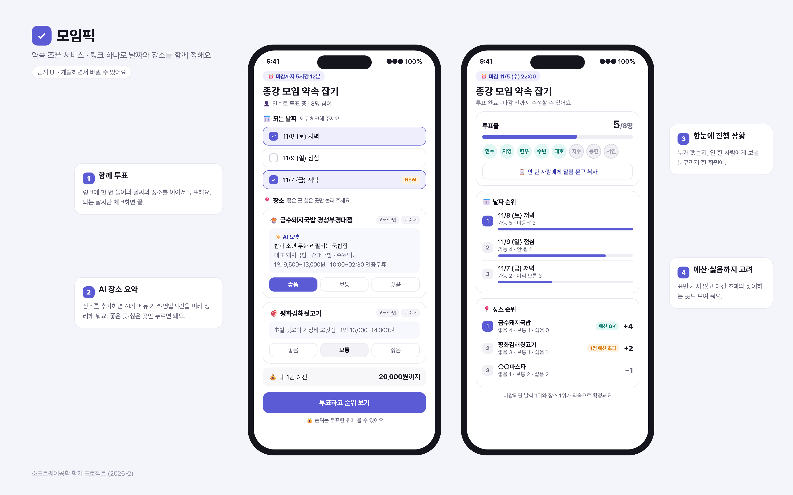
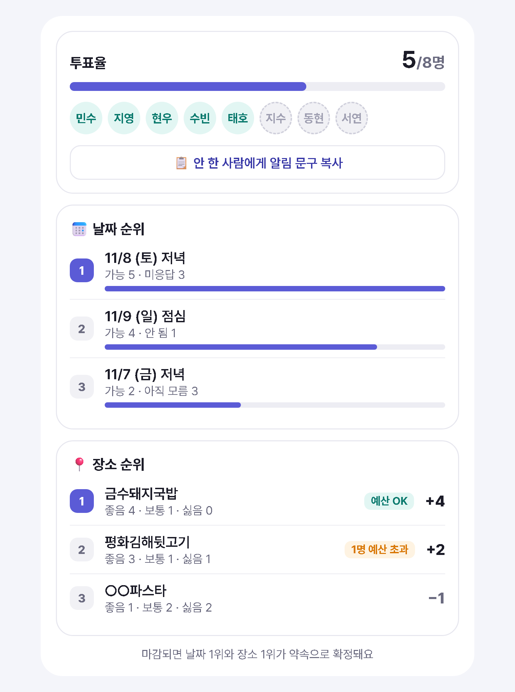
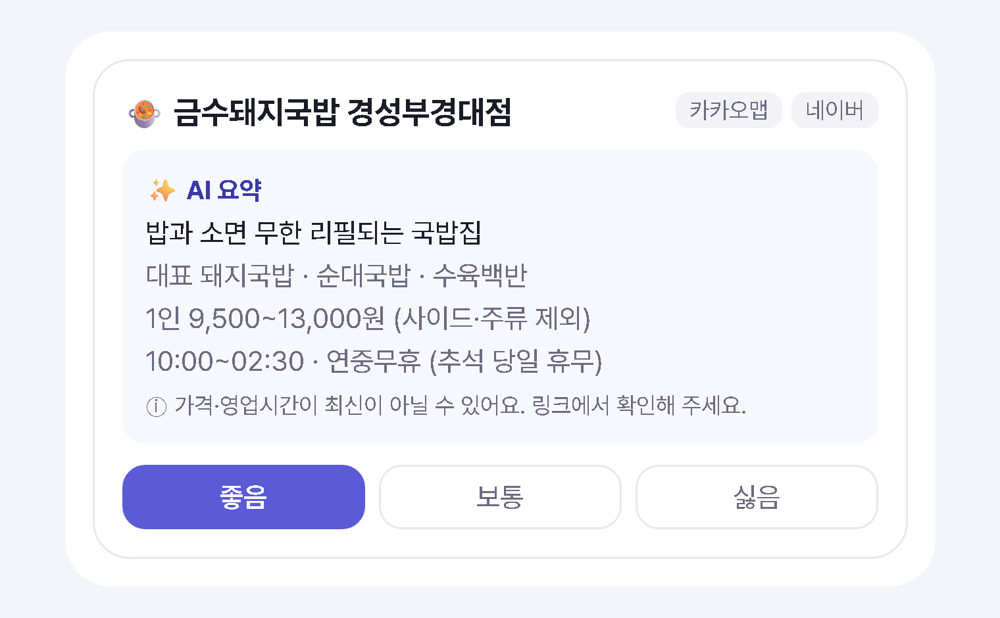
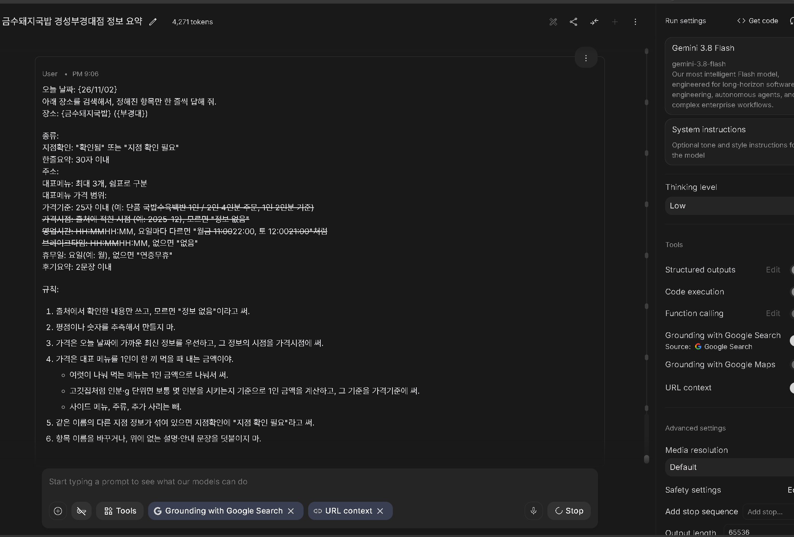
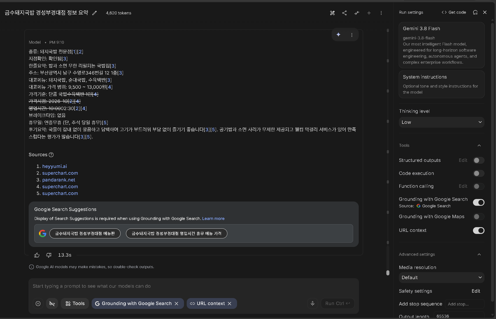

이번 학기 소프트웨어공학 수업에서 혼자 웹 서비스를 하나 만들게 됐다.
첫 글은 주제 제안이다. 누가 쓰는지, 어떤 게 불편한지, 무엇을 만드는지, 이번 학기에 어디까지 할지 정리해 봤다.

## 주제 선정 과정

처음에는 AI가 일정을 정리해 주는 학습 플래너를 생각했다.
그런데 구현 난이도도 애매하고, 정말 필요한 서비스인지도 확신이 안 섰다.

그래서 내가 실제로 자주 겪는 불편을 떠올려 봤고, 그게 모임 약속 잡기였다.
처음엔 날짜 투표 정도로 생각했는데, 그건 카톡 투표랑 다를 게 없었다. AI랑 이것저것 다듬다 보니 핵심이 몇 번 바뀌었고, 지금 모양이 됐다. (어떻게 바뀌었는지는 마지막에 적었다.)

## 1. 사용자

나는 지금 대학교 동기 모임, 동아리 모임, 고등학교 친구 모임에 속해 있다.
세 모임 다 카톡 단톡방에서 약속을 잡는데, 이 세 모임이 첫 사용자다.

쓰는 사람은 크게 둘로 나뉜다.

- 모임장: 후보를 정하고, 의견을 모아서 최종 결정하는 사람
- 참여자: 링크를 눌러서 투표만 하면 되는 사람

제일 고생하는 건 의견을 모아야 하는 모임장이라, 모임장이 편해지는 걸 먼저 생각했다.
참여자는 1분 안에 투표를 끝낼 수 있으면 된다.

## 2. 불편한 점

우리 모임은 보통 이렇게 약속을 잡는다.
누가 단톡방에 가고 싶은 곳 링크를 올리고, 카톡 투표를 만들어서 날짜나 장소를 고른다. 근데 매번 정하는 데 꽤 오래 걸린다.

- 일정이 계속 안 맞는다. 한 명이 되는 날은 다른 한 명이 안 되고, 날짜를 다시 묻는 게 반복된다.
- 의견이 달라서 정리가 안 된다. 날짜 얘기, 장소 얘기가 단톡방 여기저기 섞여서 결국 누군가 위로 올려 가며 다시 읽어야 한다.
- 투표를 안 하는 사람이 꼭 있다. 누가 안 했는지 확인해서 따로 물어봐야 한다.
- 링크와 투표가 따로 논다. 링크는 위에, 투표는 아래에 있어서 투표하려면 링크를 다시 찾아 올라가야 한다.

### 카톡 투표로는 안 되나?

사실 카톡 투표에도 후보 추가, 복수 선택, 익명 투표, 마감 시간 같은 기능은 다 있다. 투표 기능만 놓고 보면 차이가 없다.

문제는 투표가 끝난 다음이다.
날짜 결과와 장소 결과를 비교하고, 안 한 사람을 챙기고, 가게 정보를 찾아보는 건 여전히 사람이 해야 한다.

| | 카톡 투표 | 이번에 만들 서비스 |
|---|---|---|
| 날짜·장소 투표 | 투표를 따로 만들어 대화에 올림 | 한 링크에서 같이 진행 |
| 장소 정보 | 링크를 따로 찾아봐야 함 | AI가 메뉴·가격·영업시간을 요약 |
| 장소 선호 | 고른 항목만 셈 | 좋음 / 보통 / 싫음 |
| 예산 | 따로 물어봐야 함 | 내 예산보다 비싸면 "예산 초과" 표시 |
| 안 한 사람 | 투표마다 따로 확인 | 명단 기준으로 한 번에 확인 |
| 결과 | 투표마다 따로 확인 | 날짜·장소 순위를 한 화면에서 |

그래서 "더 좋은 투표 앱"보다는 약속을 정하는 과정 전체를 편하게 만드는 걸 목표로 잡았다.

물론 단점도 있다. 카톡 투표는 대화방에서 바로 누르면 되지만, 이건 링크를 열고 이름까지 골라야 한다.
한 단계가 더 있는 만큼 그보다 더 편해야 쓸 이유가 생긴다. 이건 나중에 실제로 써 본 친구들한테 물어볼 생각이다.

## 3. 만들 서비스

모임픽은 링크 하나로 날짜 투표와 장소 투표를 같이 하고, 진행 상황과 순위를 한눈에 보는 약속 조율 서비스다. 장소에는 AI 요약이 붙는다.

*아직은 임시 UI다. 왼쪽이 투표 화면, 오른쪽이 투표한 뒤 보이는 결과 화면이고, 실제 화면은 만들면서 바뀔 것 같다.*

### 쓰는 흐름

1. 모임장이 모임을 만든다. 날짜와 장소를 다 정할지 하나만 정할지 고르고, 마감 시간과 참여자 명단을 넣는다.
2. 링크를 단톡방에 공유한다.
3. 누구나 날짜, 장소 후보를 추가할 수 있다. 장소는 가게 이름(필수)과 지역, 지도 링크 정도만 넣으면 된다.
4. 투표한다.
   - 명단에서 내 이름을 고른다.
   - 되는 날짜를 전부 체크한다. 체크 안 한 날짜는 "안 됨"이다.
   - 장소는 처음에 다 "보통"으로 되어 있어서, 좋은 곳이나 싫은 곳만 누르면 된다.
   - 내 예산을 한 번 적는다.
   - 마감 전까지는 다시 들어와서 고칠 수 있다.
5. 투표가 들어올 때마다 날짜 순위, 장소 순위가 바뀐다.
6. 마감되면 날짜 1위와 장소 1위가 약속이 된다.

### 순위는 이렇게 정한다

- 날짜는 가능한 사람이 많은 순서다. 모두 되는 날짜가 없으면 누군가를 빼는 대신 "토요일: 지영 안 됨"처럼 보여 주고 다른 날짜를 추가하게 한다. 모임은 다 같이 가는 게 목표니까.
- 장소는 좋음 +1, 보통 0, 싫음 −1로 점수를 매긴다. 가격이 내 예산보다 비싸면 "예산 초과"로 표시하고, 점수가 같으면 예산 초과가 적은 쪽이 위로 간다.
- 동점이면 모임장이 고르고, 투표가 너무 적으면 마감을 연장할 수 있다.

*투표한 뒤 보이는 결과 화면. 아직 안 한 사람(점선), 미응답·아직 모름, 선호 점수(+4, +2, −1), 예산 초과 표시가 한 화면에 나온다.*

### 순위는 투표하고 나서 보인다

실시간 순위가 보이면 1등을 보고 따라 고르는 사람이 생길 것 같았다. 그래서 순위는 투표를 제출해야 보이게 했다.
투표하고 나서 바꿀 수는 있으니 완벽하게 막지는 못하지만, 적어도 첫 선택은 남의 표를 안 보고 하게 하려는 거다. 누가 투표했는지는 항상 보인다.

### 늦게 추가된 후보

누구나 후보를 추가할 수 있다 보니, 먼저 투표한 사람은 새 후보를 못 보고 지나갈 수 있다.
그래서 새 후보는 먼저 투표한 사람한테 "아직 모름"으로 보이게 하고 점수에 넣지 않는다. 다시 들어오면 "새 후보가 추가됐어요" 안내를 띄울 생각이다.

### AI 장소 요약

장소 투표를 하려면 그 가게가 어떤 곳인지, 얼마쯤 하는지 알아야 한다. 지금은 각자 지도 앱을 열어서 메뉴랑 후기를 찾아봐야 하는데, 이게 은근 귀찮다.
그래서 장소 투표 화면에 들어가면 가게마다 AI 요약이 미리 붙어 있게 만들 거다. 위 임시 UI 왼쪽 화면의 장소 카드를 크게 보면 이렇다.

*한 줄 요약, 대표 메뉴, 1인 가격, 영업시간이 미리 붙어 있고, 좋은 곳이나 싫은 곳만 누르면 된다.*

- 서버에서 Gemini API를 호출하고, 구글 검색 기능(Grounding)을 켜서 최신 정보를 찾게 한다. 응답이 10초 넘게 걸려서, 장소가 추가될 때 한 번만 만들어 저장해 둔다.
- 가격도 AI가 찾아 주고 예산 계산에도 쓴다. 다만 최신 가격이 아닐 수 있어서 "링크에서 확인해 주세요" 안내를 꼭 붙인다.
- Gemini API는 무료 사용량 안에서만 쓰고, API 키는 GitHub에 올리지 않고 환경변수로 관리한다.

실제로 Google AI Studio에서 돌려 본 화면이다.

*넣은 프롬프트 (Gemini 3.8 Flash, Google 검색 Grounding 켬, Thinking level Low)*

*결과. 종류, 영업시간, 가격 시점까지 정해진 항목으로 나왔고, 아래에 출처랑 구글 검색 제안이 같이 나온다.*

## 4. 이번 학기 개발 범위

정할 항목은 날짜와 장소, 두 개까지만 한다. 더 늘리면 투표 화면이 너무 길어진다.
로그인은 없이 링크랑 닉네임만 쓴다.

**11/16 첫 배포까지 (최소 기능)**

처음부터 끝까지 한 번은 약속을 잡아 볼 수 있는 가장 작은 흐름이다.

- 모임 만들기, 링크 공유
- 날짜·장소 후보 추가 (장소는 가게 이름, 한 줄 설명, 1인 예상 가격, 지도 링크)
- 명단에서 이름 고르고 날짜·장소 투표
- 투표별 순위 보기 (투표한 뒤에 공개)

**발표 전까지 꼭 할 것**

서비스의 차별점이 되거나, 약속을 끝까지 정하는 데 꼭 필요한 기능이다.

- 투표율, 참여 현황, 날짜·장소 순위, 남은 시간을 한 화면에
- AI 장소 요약
- 자동 갱신
- 모두 되는 날짜가 없을 때 새 날짜 추가 안내
- 마감 후 1위 확정

**여유가 되면**

없어도 핵심 흐름은 돌아가는 보완 기능이다.

- 중복 투표 방지 (고른 이름 잠그기, 같은 기기에서만 내 응답 수정), 익명 모드, 알림 문구 복사
- 휴무일 경고, NEW 표시, "아직 모름" 안내
- 후보 추가 마감, 마감 연장

다 만들면 실제 친구 모임에서 써 보고, 카톡 투표보다 편했는지 피드백을 받아서 고칠 생각이다.
특히 날짜와 장소를 같이 투표하는 것, 참여 현황, AI 장소 요약이 실제로 도움이 되는지 확인하고 싶다.

## AI 활용 기록

기획은 Claude랑 대화하면서 다듬었고, 중간에 ChatGPT한테도 한 번 검토를 받았다.
AI가 말한 걸 그대로 쓰지 않고 바꾼 것 위주로 적어 둔다.

### 조합 순위 → 따로 순위

처음엔 "날짜 × 장소" 조합마다 몇 명이 되는지 계산하는 조합 순위를 핵심으로 잡았다. 그런데 생각해 보니 실제 모임은 날짜와 장소를 따로 정한다. AI는 "날짜 먼저 정하고, 그날 오는 사람 기준으로 장소 순위"를 추천했는데, 그러면 장소 투표를 또 해야 해서 시간이 더 걸린다. 그래서 순위는 따로, 투표는 한 번에 같이 하는 걸로 정했다.

### "1명만 빠지면 되는 조합" 제거

처음 기획엔 모두 되는 날짜가 없으면 1명 빠지는 경우를 보여 주는 기능이 있었다. 근데 모임은 다 같이 가는 게 목표라 뺐고, 대신 새 날짜를 추가하게 안내한다.

### 중복 투표

처음엔 IP로 막으면 되지 않을까 했다. 그런데 강의실이나 카페처럼 같은 와이파이를 쓰면 여러 명이 같은 IP가 돼서 멀쩡한 사람까지 막힌다. 그래서 모임장이 명단을 넣고 각자 자기 이름을 고르는 방식으로 정했다.

### 날짜 후보 추가

AI는 늦게 추가된 날짜가 불리하니 날짜는 모임장만 추가하자고 했다. 하지만 실제로는 "이 날은 어때?" 하고 아무나 날짜를 꺼내니까 누구나 추가할 수 있어야 한다고 봤다. 대신 먼저 투표한 사람한테는 "아직 모름"으로 보이게 했다.

### 군중심리

실시간 순위를 보고 1등을 따라 고를 것 같아서, 참여 현황은 그대로 두고 순위만 투표한 뒤에 보이게 했다.

하지만 투표한 뒤에 순위를 보고 마음을 바꿔 다시 투표할 수는 있어서, 군중심리를 완전히 막지는 못한다는 우려가 남는다. 그렇다고 재투표를 막으면 일정이 바뀐 사람이 고칠 수 없어서 오히려 불편해진다. 그래서 첫 선택만큼은 남의 표를 보지 않고 하게 하는 정도로 타협했고, 실제로 써 보면서 재투표가 얼마나 일어나는지 확인해 볼 생각이다.

### 카톡 투표랑 뭐가 다른지

AI 하나만 믿기 그래서 ChatGPT한테 다시 물어봤다. "더 좋은 투표 앱이 아니라 약속을 정하는 과정 전체를 편하게"로 정리됐다. ChatGPT가 결과 공개 시점을 "마감 전 비공개"로 잘못 읽은 부분은 바로잡았다.

### AI 장소 요약

AI는 처음에 지도 링크 페이지는 읽어 오기 어려우니 각자 메뉴판 사진이나 메뉴 글을 붙여 넣으면 정리해 주자고 했다. 근데 사용자 편의가 1순위인데 매번 메뉴판을 복사해 오는 건 너무 번거롭다. 그래서 장소를 추가하면 AI가 직접 검색해서 요약하는 방식으로 바꿨고, 되는지 AI Studio에서 먼저 돌려 봤다. 돌려 보면서 고친 것들:

- 처음엔 AI가 후기랑 평점을 찾아보고 직접 평점을 매기게 했다("4.5/5.0"). 그런데 이 점수는 돌릴 때마다 달라질 수 있고, 화면에서 진짜 평점처럼 보여서 투표에 영향을 줄 수 있어서 빼고 후기 요약만 남겼다.
- AI가 찾은 가격은 예전 후기나 글 기준일 수 있어서 최신 가격이 아닐 수도 있다. 그래서 가격은 AI가 찾되, 링크에서 확인하라는 안내를 꼭 붙이기로 했다.
- 가격 최소·최대를 달라고 했더니 최소는 사이드 메뉴 가격, 최대는 잘 안 시키는 아주 비싼 메뉴 가격이 나왔다. 그래서 대표 메뉴를 1인이 한 끼 먹는 금액으로 기준을 바꿨다.
- 지도 링크만 줬더니 "정보 없음"이 나왔다. 링크에는 가게 번호만 있어서, 가게 이름을 꼭 받게 바꿨다.

### 임시 화면

글로만 설명하니까 한눈에 안 들어와서, 위에 넣은 임시 UI 이미지는 Claude한테 그려 달라고 했다.

## 마무리

AI는 여러 기능을 계속 제안했지만, 이번 학기에 어떤 기능을 구현하고 어떤 기능을 제외할지는 직접 판단해야 한다는 걸 느꼈다.

또한 AI가 제공한 정보가 실제와 다른 경우도 있었기 때문에, 결과를 그대로 받아들이기보다 직접 확인하고 검증하는 과정이 중요하다는 걸 배웠다.

다음 글에서는 데이터 설계(ERD)를 정리할 예정이다.
