새로운 수업 방향에 맞춰, 개발은 빠르게 끝내고 QA와 배포(Deploy) 단계에 무게를 두기로 했다. 그래서 이번 주에는 핵심 기능을 한 번에 만들어 바로 배포까지 했고, 그 뒤로는 직접 써 보며 버그를 잡고 UI를 다듬는 작은 업데이트를 이어 가고 있다. 지금은 [moimpick.vercel.app](https://moimpick.vercel.app)에서 실제로 쓸 수 있다.

막상 만들어 보니 계획할 때는 안 보이던 문제가 줄줄이 나왔다. 이번 글은 그중 가장 오래 막혔던 세 가지를, 어디서 막혔고 어떻게 고쳤는지 순서대로 적었다. 그 과정에서 바뀐 화면과 데이터 설계(ERD), AI와 협업한 과정도 같이 정리했고, 1편 기획과 비교해 그대로 만든 것, 새로 더한 것, 아직 못 한 것은 마지막에 표로 정리했다.

## 일단 만들고, 일단 배포

Next.js로 화면과 서버를 같이 만들고, DB는 Supabase, 배포는 Vercel로 했다. 모두 무료 플랜이다.

처음 배포한 화면은 이랬다. 모임 이름, 마감 시간, 명단, 날짜·장소 후보를 한 번에 적는 폼 하나로 시작하는 단순한 구조였다.

  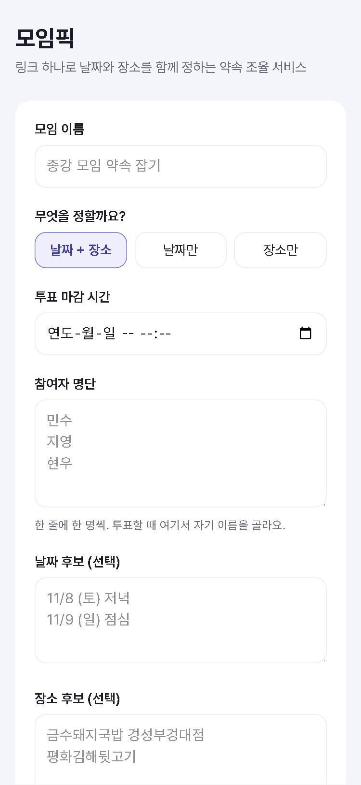
  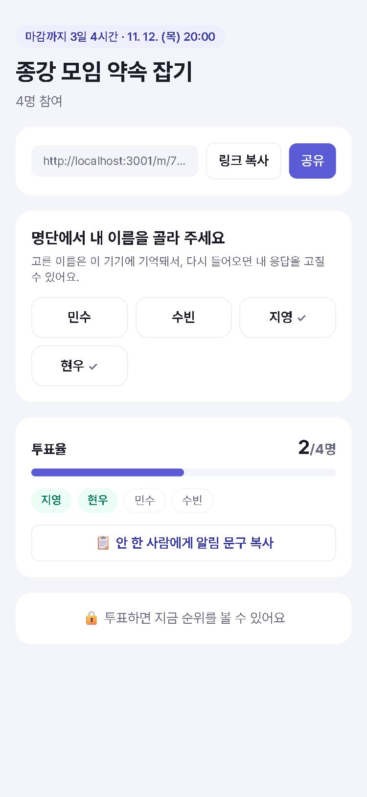
  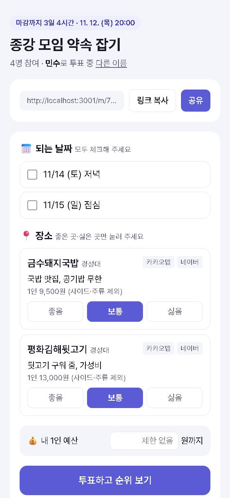
  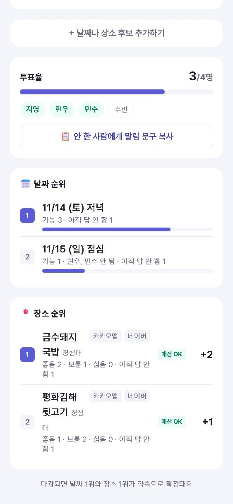

*첫 배포 버전. 왼쪽부터 모임 만들기, 이름 고르기, 투표, 결과. (나중에 git 기록으로 그때 코드를 다시 띄워서 찍었다)*

여기까지는 순조로웠다. 문제는 이 위에 기능을 하나씩 붙이고, 직접 써 보기 시작하면서부터였다.

## 막힌 것 1. 무료 API에서 막힌 AI 장소 요약

1편에서 AI Studio로 시험했을 때는 Gemini가 구글 검색까지 해서 가게 정보를 잘 정리해 줬다. 그래서 API 키만 받으면 그대로 붙일 수 있을 줄 알았다.

그런데 발급받은 키로 부르니 바로 "할당량 초과"(429)가 떴다. 모델을 바꿔 봐도 구글 검색을 켜는 순간 막혔고, 예전 모델은 "새 사용자는 더 이상 쓸 수 없음"이라고 나왔다. 알고 보니 AI Studio 화면과 API는 무료 한도가 따로였고, 무료 API에서는 구글 검색을 쓸 수 없었다. 결제 카드를 연결하면 풀리겠지만 과제 규칙상 그건 안 된다.

그렇다고 검색 없이 AI만 쓰면 없는 가격을 지어낼 수 있었다. 그래서 방향을 바꿨다. 검색은 다른 곳에서 하고, AI에게는 찾아 온 내용을 요약하는 일만 맡기기로 했다. 처음엔 네이버 검색 API를 쓰려 했는데, 개발자센터에서 검색 API 신규 신청이 막혀 있었다. 대안으로 나온 네이버 클라우드는 가입과 결제 수단 등록이 필요해서 이것도 포기했다.

마지막으로 카카오 검색 API를 시험해 봤다. 다음 블로그 후기는 내용이 별로일 것 같아 걱정했는데, 막상 블로그 검색 결과 10개를 보니 전부 네이버 블로그 글이었다. 장소 검색으로 정확한 가게 이름, 주소, 카카오맵 링크까지 받을 수 있어서 이걸로 정했다. 지금은 카카오에서 가게와 후기를 찾고, Gemini에게는 "이 검색 결과만 근거로, 정해진 항목만" 요약하게 한다. 근거를 직접 넣어 주니 AI가 없는 정보를 지어낼 여지가 확실히 줄었다.

  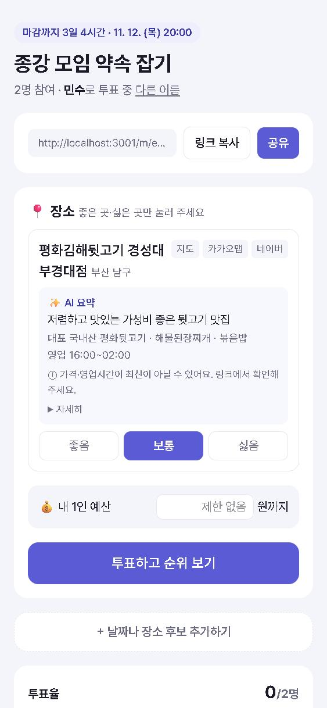
  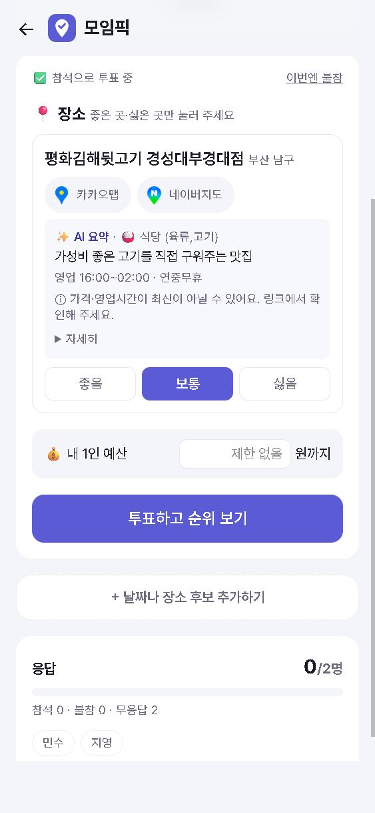

*같은 가게의 AI 요약. 왼쪽은 카카오 검색으로 바꾼 직후, 오른쪽은 지금. 종류(식당·육류)를 카카오 업종으로 붙이고, 지도 버튼과 문구를 정리했다.*

요약이 나오기 시작하자 이번엔 내용이 문제였다. 고깃집 가격이 "1인 6,500원 (1인 2인분 기준)"처럼 앞뒤가 안 맞게 나왔다. 원인은 "1인이 한 끼에 내는 예상 금액"을 계산하라고 시킨 데 있었다. 몇 인분을 먹는지 AI가 그때그때 다르게 짐작하니 답이 들쭉날쭉했다. 그래서 계산은 그만두게 하고 메뉴판 가격을 그대로 쓰게 바꿨다. 국밥이나 카페는 단품 기준, 고깃집은 1인분 기준이다.

대표 메뉴도 비슷한 문제가 있었다. 후기마다 메뉴 이름이 제각각이고, 사이드 메뉴나 세트까지 섞여 나와서 "대표"라고 보기 어려울 만큼 뒤죽박죽이었다. 투표할 때 꼭 필요한 정보도 아니라서 카드에서는 아예 뺐다. 대신 AI가 가격을 고를 때 기준으로만 안에서 쓰게 했다.

장소 종류도 비슷했다. 보드게임카페를 넣었더니 AI가 그냥 "카페"로 분류했다. 이건 AI에게 맡기지 않고 카카오가 주는 업종 정보로 정하게 바꿨다. 이 두 가지를 겪으면서, AI에게 판단을 맡길 부분과 코드로 정해 버릴 부분을 나눠야 한다는 걸 배웠다.

영업시간은 또 다른 벽이었다. 카카오맵 페이지에는 나오는데 API로는 주지 않는다. 페이지를 긁어 오면 되긴 하지만 약관에 걸려서 안 하기로 했다. 대신 "영업시간"으로 후기를 한 번 더 검색해 찾을 확률을 높이고, 화면에는 "링크에서 확인해 주세요"를 붙여서 틀릴 수 있다는 걸 알리기로 했다.

## 막힌 것 2. 다른 사람 이름으로도 되던 투표

AI 요약까지 붙이고 배포한 뒤 직접 써 보다가, 이번엔 기능이 아니라 구멍을 발견했다. 같은 링크로 들어온 사람이 명단에서 아무 이름이나 골라서 그 사람으로 투표하고, 고칠 수도 있었다.

원인은 내 설계였다. 로그인이 없으니 이름을 고르면 그 사람의 번호(ID)를 브라우저 쿠키에 넣고, 서버는 그 번호를 그대로 믿었다. 누가 어떤 이름을 고르든 서버 입장에서는 구분할 방법이 없었던 것이다.

내가 원한 건 "모임장이 올린 링크 하나로, 각자 자기 이름으로만 투표하고 고치기"였다. 카카오 로그인을 붙이면 확실하게 막을 수 있지만, 약속 하나 잡는데 로그인까지 하라고 하면 아무도 안 쓸 것 같았다. 그래서 로그인 없이 막을 수 있는 만큼 막는 이름 선착순 잠금으로 바꿨다.

이름을 처음 고른 기기에 그 이름을 묶고, 쿠키에는 번호 대신 맞히기 어려운 비밀 키를 넣었다. 고르는 순간 번호 3자리도 같이 준다. 카톡에서 열었다가 크롬으로 다시 열면 브라우저가 달라서 기억이 안 되는데, 그때 이 번호로 다시 들어오면 된다. 번호를 5번 틀리면 10분 동안 막히게 해서 아무 번호나 넣어 보는 것도 막았다. 그리고 한 번 고르면 바꿀 수 없으니, 고르기 전에 빨간 "!"로 "고르면 다시 바꿀 수 없어요"를 보여 주게 했다.

  
  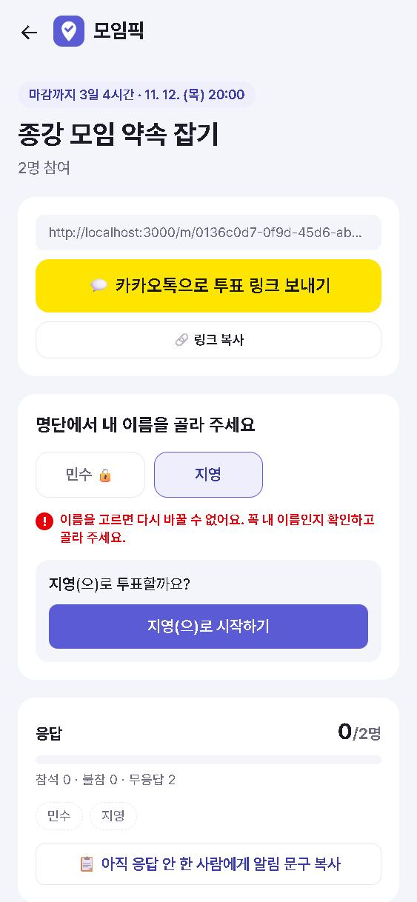
  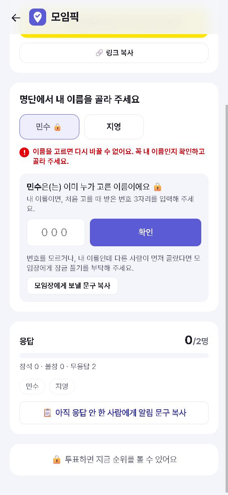

*왼쪽: 처음에는 이미 투표한 지영(✓)도 누구나 고를 수 있었다. 가운데: 지금은 고른 이름에 🔒가 붙고, 고르기 전에 빨간 경고를 보여 준다. 오른쪽: 잠긴 이름을 누르면 번호 3자리를 물어본다.*

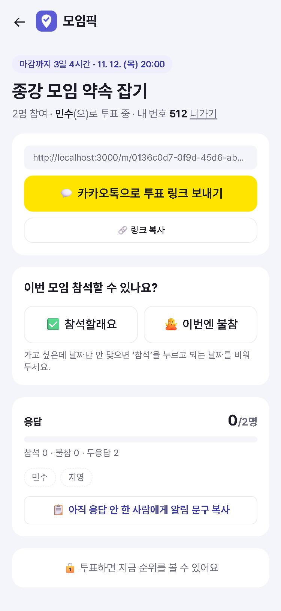

*이름을 고른 뒤 화면. 위쪽에 "내 번호 512"가 계속 보여서, 다른 브라우저로 들어올 때 이 번호를 쓰면 된다.*

그래도 로그인이 없는 한 끝까지 못 막는 경우가 하나 남는다. 장난치는 친구가 내 이름을 먼저 골라 버리는 경우다. 이건 모임장이 "잠금 풀기"로 되돌릴 수 있게 했다. 모든 경우를 완벽하게 막으려고 하기보다, 어디까지 막을지 정하고 나머지는 사람이 해결할 길을 열어 두는 쪽이 현실적이었다.

## 막힌 것 3. 직접 눌러 보니 안 되는 버튼들

배포한 사이트를 내가 직접 써 보니, 만들어 둔 버튼들이 생각처럼 움직이지 않았다.

가장 먼저 걸린 건 링크 복사와 공유 버튼이었다. 모임을 만들고 단톡방에 링크를 올리려고 눌렀는데 아무 반응이 없었다. 링크를 퍼뜨리는 게 이 서비스의 시작인데, 그게 안 되면 나머지 기능은 쓸 기회조차 없다. 브라우저가 복사를 막으면 그대로 멈춰 버리는 게 원인이어서, 막히면 다른 방법으로 한 번 더 시도하고 그래도 안 되면 글을 화면에 띄워 직접 복사할 수 있게 고쳤다.

지도 버튼은 안 되는 것과 헷갈리는 것이 섞여 있었다. 네이버 지도 버튼을 누르면 가게 검색 결과가 아니라 지도 첫 화면만 나왔다. 장소 카드에는 AI가 만들어 둔 "지도" 버튼도 있었는데, 눌러 보니 "지도"는 카카오맵의 지도 화면, "카카오맵"은 가게 검색 결과로 나뉘어 있었다. 둘 다 카카오맵이라 굳이 나눌 이유가 없어서, "지도"는 지우고 가게 검색 결과가 바로 뜨는 카카오맵 버튼만 남겼다. 그리고 남은 카카오맵·네이버지도 버튼 이름 옆에 각 앱 아이콘을 붙여 한눈에 구분되게 했다. 네이버 검색은 PC와 폰에 맞는 주소로 각각 보내게 고쳤다.

카톡 공유 버튼은 누르자마자 "잘못된 요청으로 인증에 실패하였습니다"가 떴다. 코드 문제가 아니라, 카카오 개발자 설정에 우리 사이트 주소를 등록하지 않은 게 원인이었다. 주소를 등록하자 바로 공유 창이 떴다.

공유가 되고 나니 이번엔 어떤 공유를 기본으로 둘지 고민이 생겼다. 여러 앱 중에서 고르는 공유 창이 더 넓게 쓸 수 있지만, 약속은 대부분 카톡 단톡방에서 잡는다. 그래서 카톡 공유를 크게 두고, 링크 복사와 다른 앱으로 보내기는 작게 뒀다.

이 기능들 모두 만들 때는 몰랐고, 직접 눌러 봐야 알 수 있는 문제였다. 개발을 빨리 끝내고 배포한 뒤 QA에 시간을 쓰기로 한 게 왜 맞는지 여기서 제대로 체감했다. AI 성능이 많이 좋아져서 맡기면 완벽하게 만들어 줄 줄 알았는데, 막상 써 보니 그렇지 않았다. AI가 만든 결과도 결국 직접 검증해야 한다는 걸 다시 한번 느꼈다.

## UI/UX 개선점

문제를 고치는 동안 화면도 꽤 바뀌었다. 처음 배포 때는 모임 만들기 폼 하나가 첫 화면의 전부였는데, 내가 만든 모임을 다시 찾아 들어가기가 불편했다. 지금은 진행 중인 모임, 내가 만든 모임, 새 모임 만들기로 나누고, 어느 화면에서든 위쪽 로고를 누르면 처음으로 돌아오게 했다.

  
  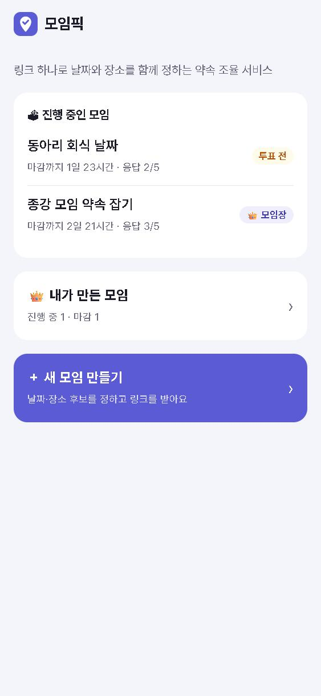

*첫 화면. 왼쪽이 처음 배포, 오른쪽이 지금.*

그런데 "내가 만든 모임"을 첫 화면에 꺼내 놓고 보니 한계가 있었다. 이 목록은 그 기기에 남은 기록으로만 찾기 때문에, 카톡 안에서 만든 모임은 크롬에서 안 보이고, 기록을 지우거나 폰을 바꾸면 모임장 화면으로 다시 들어갈 길이 없었다. 그렇다고 투표하는 친구들까지 로그인하게 만들고 싶지는 않았다. 그래서 카카오 연결은 모임장이 원할 때만 하는 선택으로 붙였다. 연결하면 카카오 회원번호 하나만 저장하고, 그 번호로 다른 기기에서도 내가 만든 모임을 다시 불러온다.

  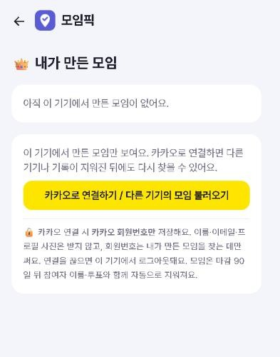
  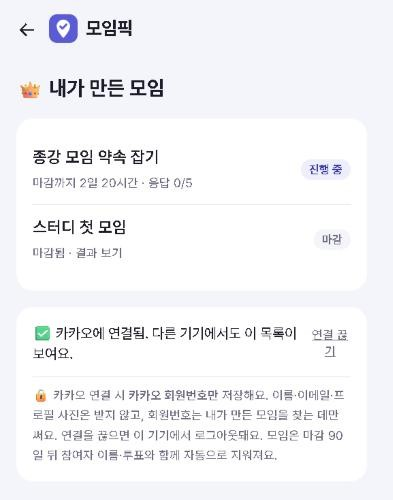

*"내가 만든 모임" 화면. 왼쪽은 연결 전으로, 이 기기에 기록이 없으면 목록이 비어 있다. 오른쪽은 카카오에 연결한 뒤로, 다른 기기에서 만든 모임까지 다시 보인다.*

모임 화면 안에서는 모임장 메뉴가 문제였다. 모임장 링크 보관, 지금 마감하기, 참여자 추가, 명단에서 빼기, 이름 잠금 풀기까지 기능을 하나씩 붙이다 보니, 펼쳐진 메뉴가 휴대폰 화면 한 장을 통째로 차지했다. 정작 자주 보는 순위는 그 아래로 밀려 있었다. 이 기능들은 가끔 한 번씩만 쓰는 것들이라, 평소에는 "모임장 메뉴" 한 줄짜리 카드로 접어 맨 아래에 두고 필요할 때만 펼치게 했다.

  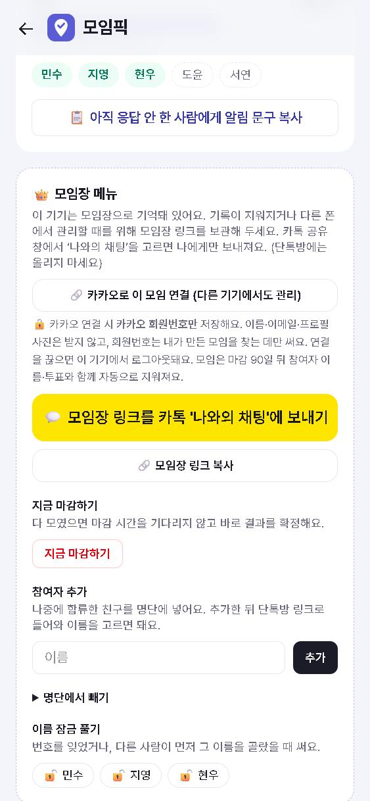
  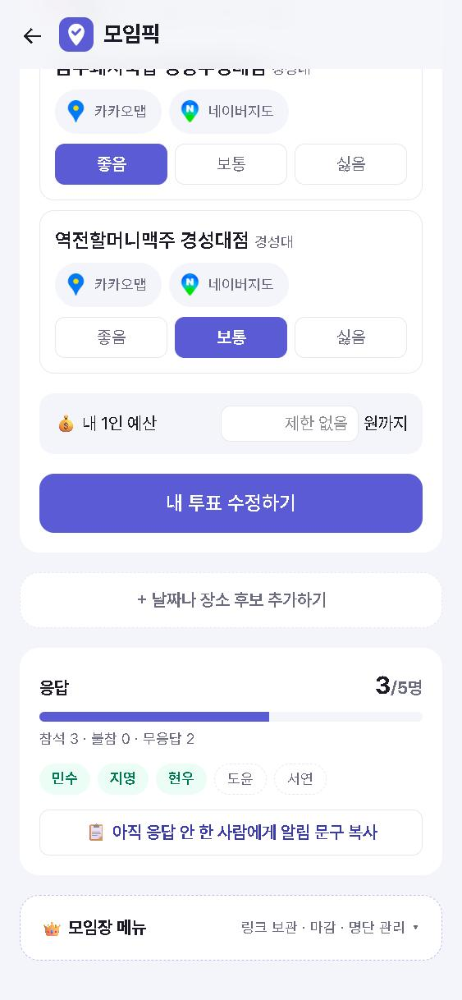

*모임장 메뉴. 왼쪽은 전으로, 펼쳐진 메뉴가 화면을 거의 다 덮는다. 오른쪽은 지금으로, 맨 아래에 한 줄로 접혀 있다.*

단톡방에 링크를 올렸을 때 보이는 카드도 바꿨다. 예전에는 "모임픽"이라는 글자만 나와서 무슨 모임인지 알 수 없었다. 지금은 큰 이미지가 붙고, 투표 링크를 카톡으로 보내면 모임 이름과 마감 시간, "투표하러 가기" 버튼이 같이 간다.

  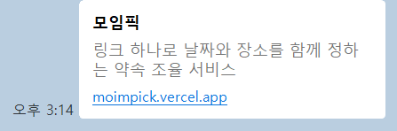
  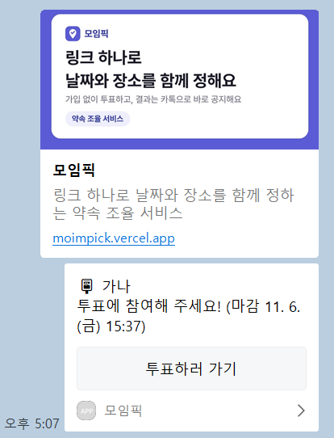

*카톡에 올린 링크 카드. 왼쪽이 전, 오른쪽이 후.*

## 고치다 보니 바뀐 데이터 설계 (ERD)

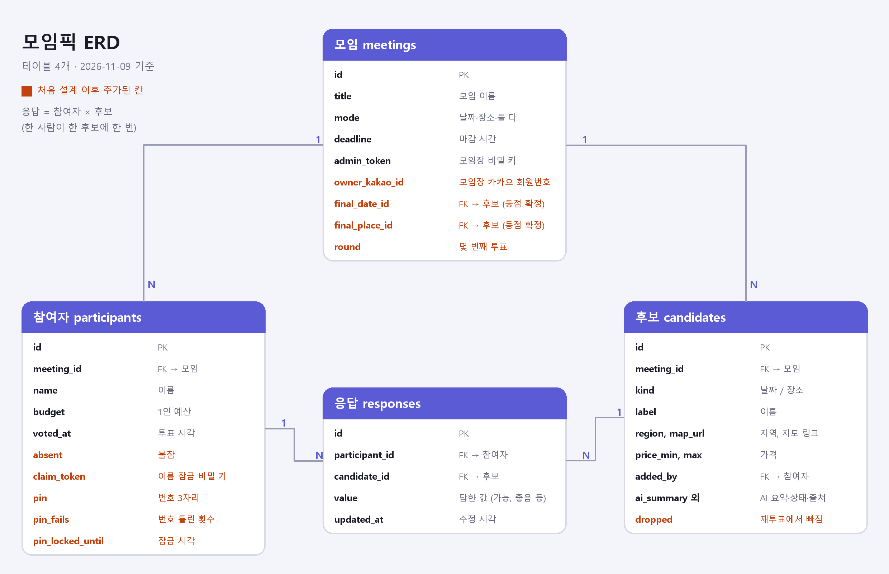
*주황색 칸이 처음 설계 이후 추가된 칸이다.*

테이블은 네 개다. 모임이 하나 있고, 모임에는 참여자(명단)와 후보(날짜·장소)가 여러 개 딸린다. 응답은 "어떤 참여자가 어떤 후보에 어떻게 답했나"를 한 줄씩 저장해서, 참여자와 후보를 이어 준다.

처음 설계에서는 이 네 개에 꼭 필요한 칸만 있었고, AI 요약 칸 세 개(요약, 요약 상태, 출처)만 미리 넣어 뒀다. 그런데 이번 주에 문제를 고치고 기능을 더하다 보니 칸이 하나둘 늘었다. 돌아보면 늘어난 칸 하나하나가 이번 주에 고민했던 지점이다. 다른 사람 이름으로 투표하는 걸 막으려고 참여자에 비밀 키, 번호 3자리, 번호 틀린 횟수, 잠금 시각이 생겼다. 못 오는 사람과 아직 투표 안 한 사람을 구분하려고 불참 여부를 더했고, 1등이 동점일 때 모임장이 고르거나 동점 후보로만 다시 투표할 수 있게 모임에 확정 날짜·장소와 몇 번째 투표인지를, 후보에 재투표에서 빠졌는지를 넣었다. 기록이 지워지거나 다른 폰이어도 내가 만든 모임을 찾을 수 있게 모임에 모임장 카카오 회원번호도 추가했다.

## AI와의 협업 과정

이번 주 개발은 Claude Code에게 맡겼다. 다만 알아서 끝까지 만들게 한 건 아니고, 방향과 기준은 내가 정하고 만드는 일을 맡기는 식이었다.

시작은 "이제 실제로 만들어 보자. 어떻게 만들면 되는지 순서를 알려 줘"였다. 순서를 듣고 나서 "서비스를 빨리 만든 다음, 기능을 넣고 버그를 고치는 방향으로 가자"고 정했고, Supabase와 Vercel 가입, API 키 입력은 직접 했다. 그 뒤로는 "만들어 줘", "배포하자", "AI 요약 붙이자"처럼 한 단계씩 시켰다.

만들어 온 결과는 직접 보고 기준을 구체적으로 다시 줬다. AI 요약 가격이 이상하게 나왔을 때는 "1인 예상 금액으로 하니 너무 안 맞는다. 단품이면 그 가격을, 고기 같은 건 대표 메뉴 1인분 가격으로 하자"고 했고, 장소를 전부 "가게"라고 부르는 게 걸려서 "카페나 보드게임방도 될 수 있는데 그것도 다 가게로 치나?"라고 물었다. 한 번에 못 알아들을 때도 있었다. 날짜 후보를 마감 시간처럼 고르게 해 달라고 했더니 30분 단위 목록으로 만들어 와서, "30분 단위로 끊지 말고 마감 시간 정할 때 쓰는 날짜 서식으로 해 달라니까"라고 다시 말해야 했다.

버그는 직접 눌러 보고 찾은 걸 그대로 전했다. "아직 링크 복사, 공유 버튼이 작동을 안 해. 네이버 링크를 눌렀을 때 검색이 제대로 안 되는데 확인해 보고 고쳐 봐"처럼 어디서 무엇이 안 되는지 말하면, 원인은 AI가 찾아서 고쳤다. 카톡 공유 오류도 화면에 뜬 문구를 그대로 붙여 넣어 물어봤다.

큰 기능은 아이디어를 내가 먼저 냈다. 다른 사람 이름으로 투표가 되는 걸 보고 "개인마다 고유번호를 발급받아서, 번호를 입력하면 내 투표가 유지되게"라는 아이디어와 "같은 링크로 들어와도 다른 이름으로는 투표 못 하고, 본인 투표만 고칠 수 있게"라는 목표를 줬다. 이걸 바탕으로 이름 잠금이 설계됐고, 번호를 세 자리로 하고 고르기 전에 빨간 "!"로 경고를 띄우는 것도 내가 정했다. 동점일 때 동점 후보로만 다시 투표하는 기능, 기록이 지워져도 카카오로 내 모임을 찾는 기능도 같은 식으로 시작했다.

반대로 내가 꺼낸 아이디어를 AI와 따져 보고 접은 것도 있다. 영업시간을 가져오려고 "차라리 크롤링은 안 되나?"라고 물었을 때는 약관에 걸린다는 걸 확인하고 하지 않기로 했다. 모임장이 아이디와 비밀번호로 가입해서 모임을 관리하게 할까도 고민했지만, 간단한 투표에 가입까지 붙이면 오히려 귀찮아할 것 같아서 접고, 원하는 사람만 카카오로 연결하는 쪽을 택했다.

## 배운 것

이번 주를 정리하면, 막힌 곳마다 원인은 내가 너무 쉽게 믿은 것에 있었다.

AI Studio에서 됐으니 API에서도 될 거라고 믿었다가 무료 한도에 막혔다. 외부 API는 무료 조건이 바뀌거나 신규 신청이 닫히기도 해서, 한 곳에만 기대지 않고 바꿀 수 있게 만들어 두는 게 중요했다. 브라우저가 보낸 번호를 그대로 믿었다가 다른 사람 이름으로 투표가 됐다. "브라우저가 보낸 값은 믿지 않는다"는 원칙이 이번에 가장 크게 남았다. 만들어 뒀으니 당연히 될 거라고 믿었다가, 직접 눌러 보니 복사 버튼과 지도 버튼이 안 됐다.

AI도 마찬가지였다. 가격 계산이나 장소 종류처럼 AI가 흔들리는 부분은 기준을 정해 주거나 아예 코드로 정했다.

결국 이번 주의 결론은 AI를 너무 맹신하지 말자는 것이다. 성능이 아무리 좋아져도 AI가 완벽할 수는 없고, 만든 결과는 사람이 항상 검토해야 한다는 걸 직접 겪으면서 알게 됐다. 그리고 AI에게 일을 맡길 때도 두루뭉술하게 말하기보다 구체적으로 지시하고, 안 되는 부분은 어디서 무엇이 안 되는지 확실하게 피드백할수록 AI가 빨리 알아듣고 일이 빠르게 진행됐다. 앞에서 적은 가격 기준이나 버그 설명처럼 기준을 분명하게 줬을 때는 대부분 한 번에 고쳐졌다.

다음 주에는 추가로 필요한 기능이 있다면 더 붙여 보고, 친구들에게 실제로 써 보라고 한 뒤 받은 피드백과 버그를 고치는 과정을 적을 예정이다.

## + 1편 기획과 비교

1편에서 기획한 것과 지금 모습을 나란히 놓고 정리해 봤다.

먼저 기획대로 만든 것들이다.

| 1편 기획 | 지금 |
|---|---|
| 모임장이 모임 이름·마감 시간·명단을 넣고 링크를 단톡방에 올림 | 그대로 |
| 링크를 연 누구나 날짜·장소 후보 추가 | 그대로 |
| 명단에서 내 이름 고르기 | 그대로, 여기에 이름 잠금을 더함 |
| 되는 날짜 체크, 내 예산, 장소는 기본 "보통"에 좋음·싫음만 누르기 | 그대로 |
| 날짜는 되는 사람 순, 장소는 좋음 +1 / 보통 0 / 싫음 −1 | 그대로 |
| 예산보다 비싸면 "예산 초과" | 그대로 |
| 다 되는 날짜가 없으면 "토요일: 지영 안 됨"으로 보여 주고 날짜 추가 유도 | 그대로 |
| 투표 전엔 순위를 숨기고, 투표하면 바로 공개 | 그대로 |
| 늦게 올라온 후보는 먼저 투표한 사람에게 "아직 모름"으로 두고 점수에서 뺌 | 그대로 |
| 후보를 추가하면 단톡방에 붙일 알림 문구 복사 | 그대로, 안 한 사람 재촉 문구도 더함 |
| 참여 현황과 순위를 한 화면에서, 자동 갱신 | 그대로 |
| 마감되면 1위가 약속으로 확정 | 그대로, 동점 처리를 더함 |
| 중복 투표 방지 (시간 남으면 할 것) | 이름 선착순 잠금과 번호 3자리로 구현 |
| 장소마다 AI 요약 | 방식이 바뀜: 구글 검색 대신 카카오 검색 결과를 Gemini가 요약, 대표 메뉴는 카드에서 뺌 |
| 11/16 첫 배포 | 11/4에 먼저 배포 |

다음은 기획에는 없었는데 만들면서 더한 것들이다. 대부분 직접 써 보다가 막혀서 생겼다.

| 더한 것 | 계기 |
|---|---|
| 이름 잠금과 번호 3자리, 모임장의 잠금 풀기 | 다른 사람 이름으로 투표가 됐음 |
| 개인 불참 버튼, 결과는 참석으로 답한 사람 기준 | 안 오는 사람 때문에 결과가 안 정해짐 |
| 1등 동점일 때 모임장이 고르기 / 동점 그대로 공지 / 동점 후보로 재투표 | 기획에는 동점 처리가 없었음 |
| 지금 마감하기, 참여자 추가·빼기 | 모임장이 운영하면서 필요해짐 |
| 결과 공지: 카톡 공유 카드, 문구 복사, 캘린더에 추가 | 확정 다음 단계인 "알리기"가 기획에 없었음 |
| 카톡 링크 미리보기 카드 | 링크를 올리면 글자만 보였음 |
| 카카오맵 링크로 장소 추가, 장소 종류(식당·카페·술집·놀거리) | 이름만으로는 다른 지점이 잡히고, 식당 말고도 모임 장소가 많음 |
| 첫 화면 나누기, 내가 만든 모임, 카카오 연결(선택) | 내가 만든 모임을 다시 찾기 어려웠음 |
| 날짜를 달력·시간으로 고르기, 칸 하나에 하나씩 입력 | 글자로 적으면 형식이 제각각 |
| 마감 90일 뒤 자동 삭제, 개인정보 안내 | 이름과 카카오 정보를 받기 시작함 |
| 모임장 메뉴 접기, 저장 알림, 첫 방문 안내 | 직접 써 보며 다듬음 |

마지막으로 아직 못 한 것들이다.

| 아직 못 한 것 | 지금 상태 |
|---|---|
| 휴무일 경고 | AI 요약에 휴무일은 나오지만, 날짜 후보가 휴무일과 겹칠 때 경고하지는 않음 |
| 익명 모드 | 보류. 명단으로 누가 안 했는지 보여 주는 방식과 어떻게 같이 둘지 더 고민해야 함 |
| 실제 사용 평가 | 다음 주에 친구들에게 써 보게 하고 투표율, 정해지기까지 걸린 시간, 카톡보다 편했는지를 볼 예정 |
| 모임장의 후보 삭제, 마감 연장 | 아직 |
| 인원이 많을 때 화면 (이름 검색, 목록 접기) | 아직 |
| 단톡방 인원 스크린샷으로 명단 자동 추가 | 아직 |
