지난주에 첫 배포를 하고 나서, 이번 주에는 두 가지를 했다. 하나는 강의에서 새로 나온 시스템 구성 조건에 맞추는 일이고, 다른 하나는 직접 써 보면서 걸리는 곳을 고치는 일이다. 친구들에게 링크를 돌리기 전에, 내가 먼저 써 보고 막을 수 있는 건 막아 두고 싶었다.

이번 글에서는 강의 조건을 뒤늦게 맞춘 일, 장소 이름을 잘못 해석하던 문제, 단톡방 캡처로 명단을 채우면서 겪은 일을 중심으로 정리했다. 그 밖에 달라진 화면과 2편에서 남겨 둔 일들의 결과도 함께 기록했다.

## 뒤늦게 맞춘 강의 조건

11주차 강의에서 시스템 구성 필수 조건이 나왔다. 화면, 서버, PostgreSQL 데이터베이스를 Docker Compose로 한 번에 띄울 수 있어야 하고, 저장소는 비공개로 두고 교수님을 초대해야 한다. 점검해 보니 다른 조건은 다 맞았는데 Docker Compose만 아예 없었다. 개발 단계나 Docker 모두 이번에 새로 배운 개념이라 아직 머릿속에 제대로 정리가 안 돼 있었고, 그래서 뼈대를 먼저 만드는 걸 깜빡했던 것이다.

원래 순서대로라면 뼈대(실행 환경, 배포)를 먼저 만들고 기능을 붙였어야 했지만, 나는 기능을 먼저 만들고 뼈대를 나중에 맞춘 셈이다. 다행히 처음부터 비밀 키를 코드와 분리해 두었고, 배포도 Vercel과 Supabase로 나뉘어 있어서 기존 코드는 몇 줄만 고치면 됐다. 그래도 이번 일로, 아무것도 모르고 개발을 시작하기보다 적어도 개발 과정 같은 기본 개념은 알고 시작해야 한다는 걸 느꼈다.

정해야 했던 건 "배포까지 Docker로 바꿀 것인가"였다. 강의 토론 항목에도 "서버 1대 + Compose"와 "무료 관리형으로 나누기"가 나란히 있었다. 배포는 지금처럼 무료 관리형(Vercel + Supabase)으로 두고, Docker Compose는 누구나 명령 한 줄로 똑같이 실행해 볼 수 있게 하는 용도로 정했다. 모임픽은 데이터베이스에 바로 붙지 않고 Supabase가 열어 주는 API를 거쳐서 붙는 구조라, 로컬에서도 같은 방식이 되도록 화면·서버(web), DB API(api), 데이터베이스(db) 세 개로 나눴다.

실행 환경을 맞춘 뒤에는 제대로 동작하는지 확인할 방법도 만들었다. 서버와 데이터베이스가 살아 있는지 화면 없이 볼 수 있는 헬스체크 주소(`/api/health`)를 만들었다. 순위 계산과 휴무일 규칙에는 자동 테스트를 붙였다. 불참한 사람은 빼고, 늦게 올라온 후보는 "아직 모름"으로 두고, 동점이면 모임장이 고른 후보로 정하는 식의 규칙을 상황과 정답으로 적어 두면, 명령 한 줄로 몇 초 만에 확인된다. 테스트가 진짜 잡아 주는지 보려고 "불참한 사람은 빼기" 한 줄을 일부러 지워 봤더니 3개가 실패로 떴다.

## 서울 중식당이 된 "송정"

장소 후보에 가게 이름 대신 "서면", "해운대"처럼 지역 이름을 넣어 봤다. 모임에서는 가게보다 동네를 먼저 정하는 일이 흔하기 때문이다. 그런데 AI 요약이 엉뚱했다. "서면"은 서면역 지하철역으로, "송정"은 서울 강서구의 중식당으로 요약됐다. 카카오 검색 1위를 무조건 그 장소로 보고 요약하고 있었던 것이다.

  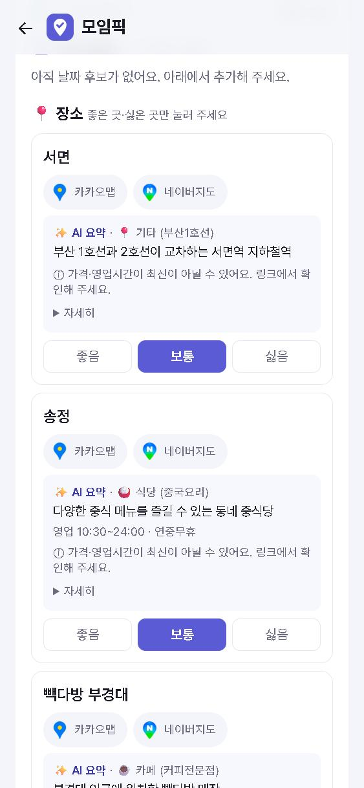
  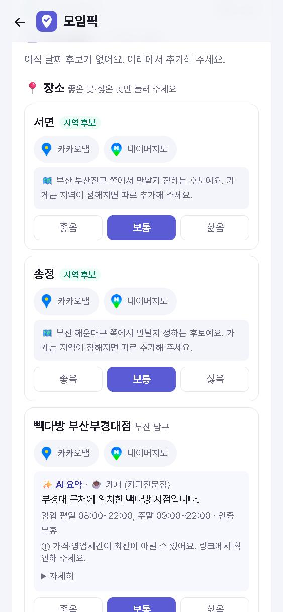

*같은 입력(서면, 송정, 빽다방 부경대)의 장소 카드. 왼쪽은 2편 시점, 오른쪽은 지금. (2편 때 코드를 다시 띄워 같은 입력으로 찍었다)*

처음에는 지역 이름이면 "지역 후보"로 받게 했다. 카카오가 검색어 전체를 지역으로 알아보거나("해운대", "부산"), 검색 1위가 지하철역·학교처럼 위치를 가리키는 곳이면("서면" → 서면역) 가게 요약 대신 "부산 부산진구 쪽에서 만날지 정하는 후보예요"라고 보여 준다. 그런데 "광안리"를 넣어 보니 이번엔 해수욕장이 요약됐다. "광안리에서 보자"는 보통 동네를 뜻하니까, 해변 이름만 적으면 지역 후보로 보고 "광안리해수욕장"처럼 적었을 때만 놀거리로 요약하게 했다.

"송정"은 더 까다로웠다. 서울, 부산, 광주, 강릉에 다 있는 이름이라 "부산 송정"으로 찾아도 카카오가 부산 강서구 송정동을 골랐다. 그래서 규칙을 정했다. 검색 결과가 여러 시·도에 흩어져 있으면 모호하다고 보고, 같은 모임의 다른 장소들이 부산이면 부산 결과를 고른다. 그래도 모르면 추측하지 않는다. 처음엔 모르면 지역을 물어보게 했는데, 장소 하나 때문에 모임 만들기가 막히면 귀찮을 것 같아서 후보로는 받고 AI 요약만 건너뛰게 바꿨다.

한편 "빽다방 부경대"처럼 지점 이름은 몰라도 대략적인 위치를 아는 경우도 있었다. 카카오가 "부경대"를 위치로 알아보면 그 좌표에서 가장 가까운 빽다방을 찾아 정확한 지점(빽다방 부산부경대점)으로 넣게 했다. 장소 입력 안내도 "지점까지 적어 주세요"에서 "지점이나 대략적인 위치를 같이 적어 주세요"로 바꿨다.

  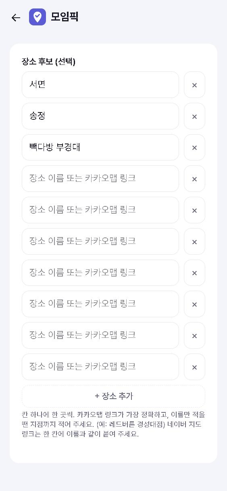
  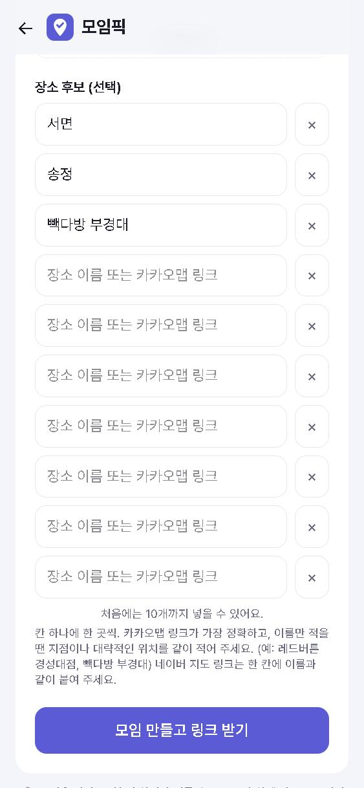

*장소 입력 칸. 안내 문구가 바뀌었고, 처음 넣을 수 있는 후보를 10개로 제한했다. (아래 "써 보기 전에 막아 둔 구멍")*

## 단톡방 캡처로 명단 채우기

모임 명단을 한 명씩 치는 대신, 카톡 대화상대 목록을 캡처해서 붙이면 이름이 채워지면 좋겠다고 생각했다. 다만 캡처에는 다른 친구들의 프로필 사진(얼굴)도 같이 찍혀 있어서, 그대로 AI에 보내기는 마음에 걸렸다.

그래서 얼굴은 보내지 않게 만들었다. 카톡 대화상대 목록은 왼쪽에 프로필 사진, 오른쪽에 이름이 있다. 이 점을 이용해 캡처를 서버로 보내기 전에 폰 브라우저 안에서 왼쪽 사진 줄을 잘라 내고, 흑백으로 바꾸고, 작게 줄인 이미지만 보내게 했다. 보내기 전에 "이 부분만 보내서 이름을 읽어요" 미리보기를 보여 줘서 얼굴이 빠진 걸 눈으로 확인할 수 있고, 이미지는 어디에도 저장하지 않는다. 읽은 이름도 바로 저장하지 않고 명단 칸에 채워서, 틀린 이름은 고치고 안 올 사람은 빼게 했다.

  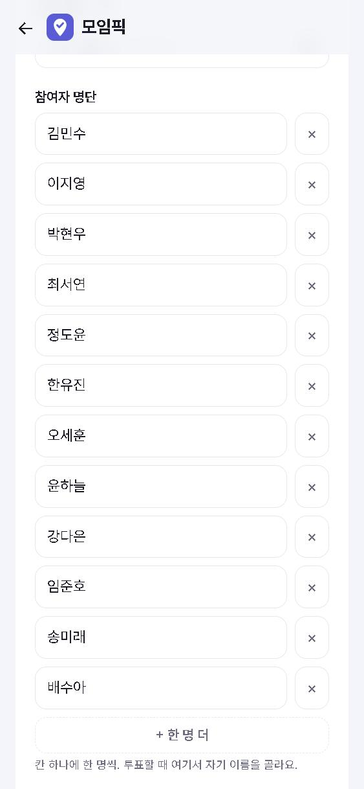
  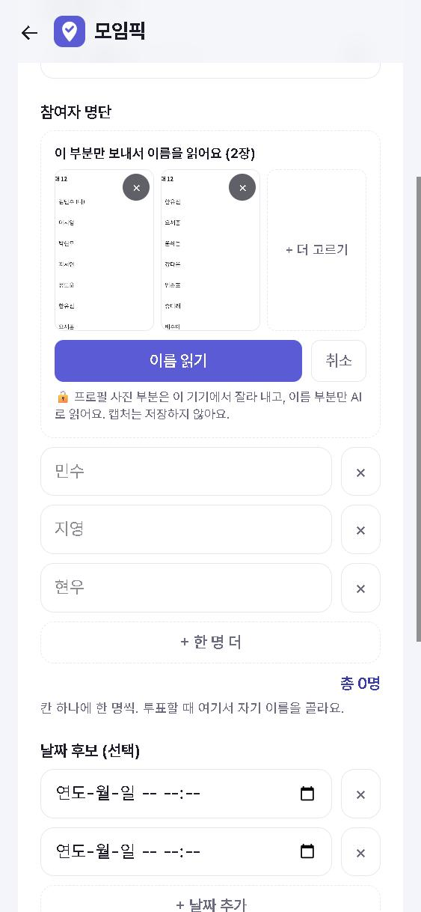
  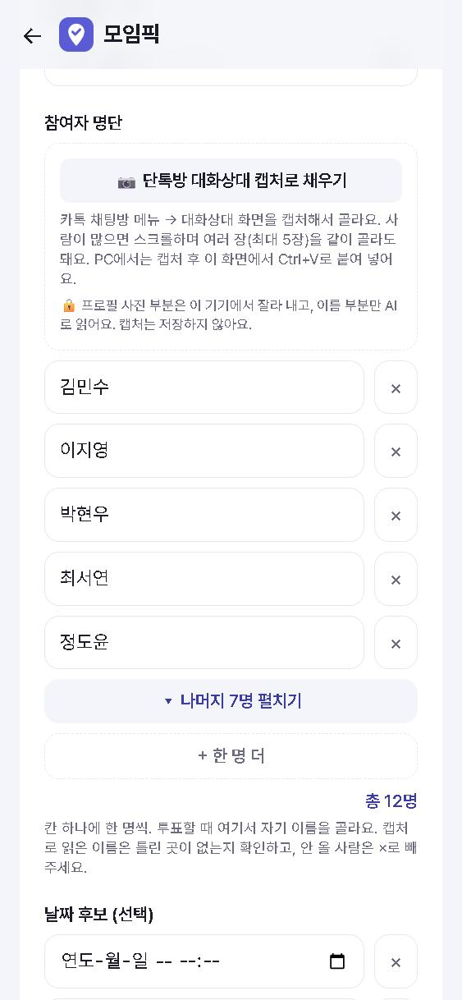

*왼쪽: 전에는 12명을 한 칸씩 직접 적어야 했다. 가운데: 스크롤 캡처 2장을 고르면 프로필 사진 줄을 잘라 낸 미리보기가 나온다. 오른쪽: 겹친 사람은 한 번만 들어가 12명이 채워지고, 앞 5명만 보이게 접힌다. (예시로 만든 대화상대 화면이다)*

가짜 캡처로 시험할 때는 잘 됐는데, 실제 카톡 캡처로 써 보니 두 가지가 걸렸다. 첫째, 성이 잘렸다. 왼쪽 22%를 고정으로 잘랐는데 실제 폰에서는 이름이 그보다 앞에서 시작해서, "김민수"와 "이민수"가 둘 다 "민수"가 되고 중복 제거 때문에 한 명이 사라졌다. 그래서 고정 비율 대신 이미지에서 사진 줄이 끝나는 곳을 직접 찾아 자르게 바꿨다. 사진 줄은 진하고, 사진과 이름 사이는 비어 있다는 점을 이용했다. 이름이 완전히 같은 사람이 있으면 지우지 않고 "박지훈 (2)"처럼 번호를 붙여 두게 했다. 둘째, 사진이 한 장만 올라갔다. 사람이 많으면 스크롤하며 여러 장을 찍어야 하니, 최대 5장까지 받고 앞 장의 끝과 다음 장의 앞에 겹친 사람은 한 번만 넣게 했다.

여기서 자동 테스트가 한 번 더 쓸모를 보였다. 이름을 정리하는 규칙에 테스트를 붙였더니, 화면 위쪽의 인원수 "6명"이 "명"이라는 이름으로 남는 버그가 바로 잡혔다. 직접 화면으로만 봤다면 한참 뒤에야 알았을 것이다.

명단이 길어지면 화면도 길어져서, 캡처로 불러온 명단은 앞 5명만 보이게 접고(나머지는 "펼치기"), 아래에 총 인원을 표시했다.

## 써 보기 전에 막아 둔 구멍

친구들에게 링크를 돌리기 전에 코드를 다시 훑어보니, 모임 만들기에 입력 길이와 개수 제한이 거의 없었다. 장소 하나마다 카카오 검색과 AI 요약이 돌아가는데, 누가 장난으로 장소 수백 개짜리 모임을 만들면 무료 한도가 한 번에 바닥날 수 있었다. 그래서 모임 이름 40자, 명단 50명, 처음 날짜·장소 후보 각 10개처럼 화면과 서버 양쪽에서 막았다.

한 번에 많이 넣는 것만 막으면 여러 번 반복하는 건 못 막는다. 그래서 같은 사람이 10분에 모임을 5개 넘게 만들면 잠시 막는 요청 횟수 제한도 넣었다. 사람을 구분하려면 접속 주소(IP)가 필요한데, 이건 그대로 저장하지 않고 알아볼 수 없게 바꾼 값만 하루 동안 남겼다가 지운다.

## UI/UX 개선점

원래 모임을 모아 보고 관리하는 기능은 모임장을 위한 것이었다. 그런데 참여자도 초대받은 모임이 많아지면, 매번 단톡방에서 링크를 찾아 들어가 확인하는 게 귀찮을 것 같았다. 그래서 참여자도 로그인해서 초대받은 모임을 관리하게 할까 고민했다. 하지만 투표 하나 하려고 로그인까지 해야 하면 "가입 없이 링크 하나로"라는 처음 취지와 맞지 않고, 서비스가 커지는 만큼 쓰기는 오히려 불편해질 것 같았다. 결국 로그인은 넣지 않고, 이 기기에서 이름을 고른 모임을 첫 화면에 모아 보여 주는 쪽으로 개선했다.

첫 화면은 "진행 중인 모임 / 마감된 모임"으로 나눴다. 참여자도 언제든 모임을 만들면 모임장이 되니까, 모임장용과 참여자용을 따로 나누기보다 내가 만든 모임과 참여한 모임을 한 목록에 섞고 모임장이었던 곳에만 👑을 붙였다. 마감된 모임도 목록에서 바로 사라지지 않고 남아 있어서, 결과를 다시 보려고 단톡방 링크를 찾을 필요가 없다.

  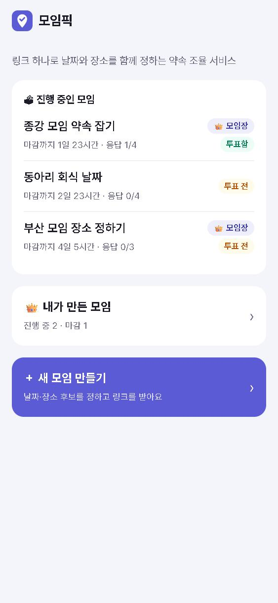
  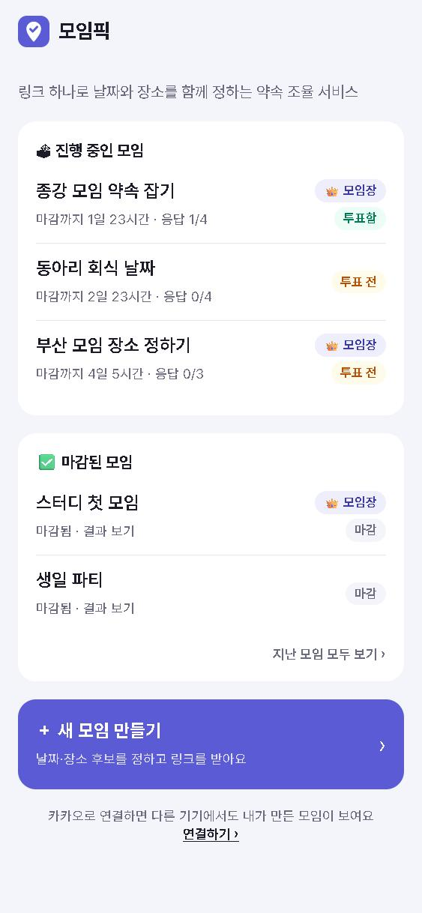

*첫 화면. 왼쪽이 전, 오른쪽이 지금.*

"내가 만든 모임" 화면은 참여한 모임까지 보여 주는 "내 모임"으로 바꾸고, 내 목록에서 지울 수 있게 했다. (모임과 다른 사람의 투표는 그대로 남는다)

  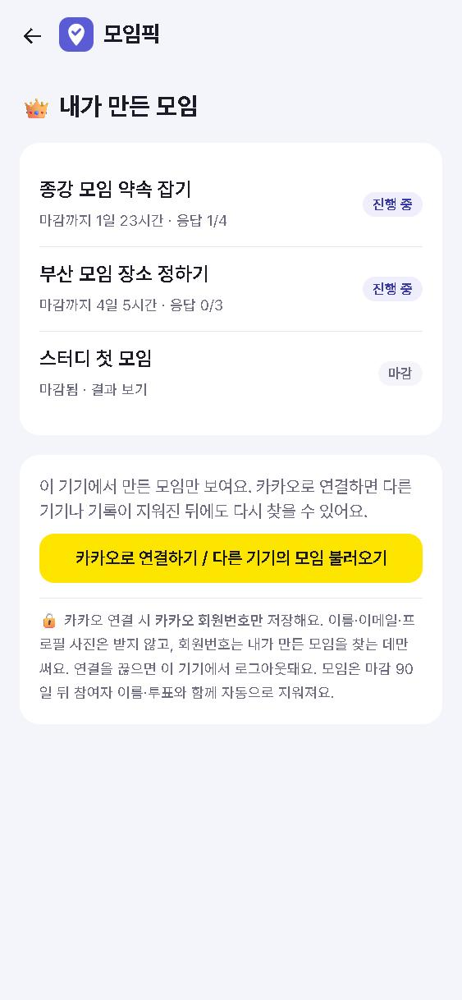
  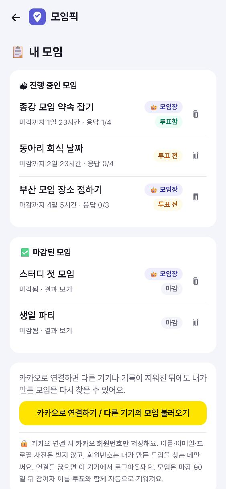

*"내가 만든 모임"에서 "내 모임"으로.*

모임장 메뉴에는 2편에서 남겨 둔 후보 지우기와 마감 연장을 넣었다. 누구나 후보를 추가할 수 있어서, 장난으로 넣은 후보를 지울 방법이 필요했다.

  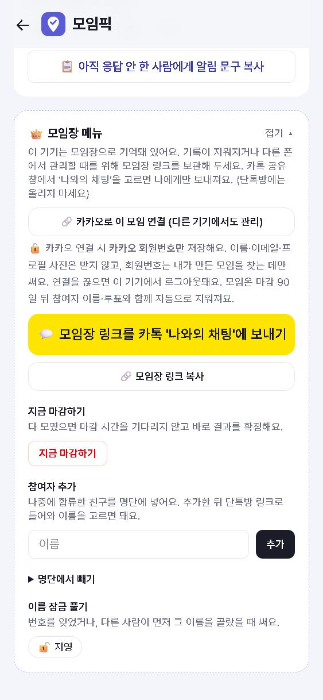
  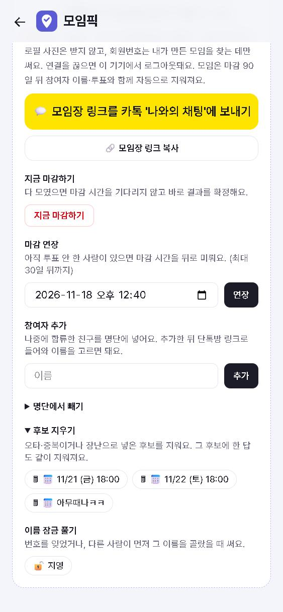

*모임장 메뉴. 오른쪽에 마감 연장과 후보 지우기가 생겼다.*

휴무일 경고도 넣었다. AI 요약에 휴무일이 있어도, 날짜 후보가 그 요일이면 아무도 몰랐다. 이제는 장소 카드, 순위, 확정 결과에서 "11/23 (월)은 이곳 휴무일일 수 있어요"라고 알려 준다. 휴무일은 AI가 후기에서 찾은 정보라 틀릴 수 있어서, 막지는 않고 지도 링크에서 확인하라고만 한다.

  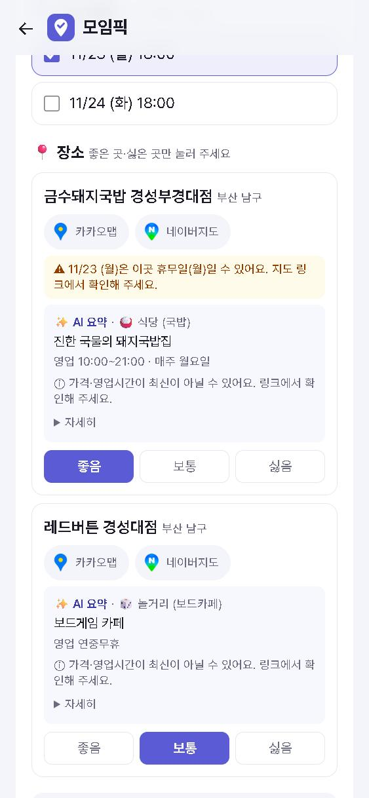
  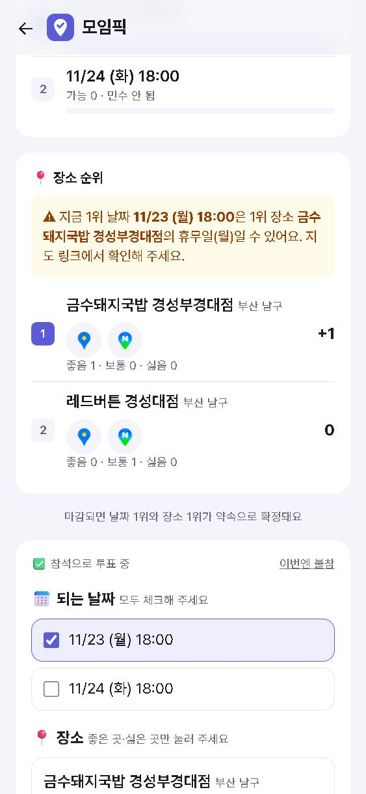
  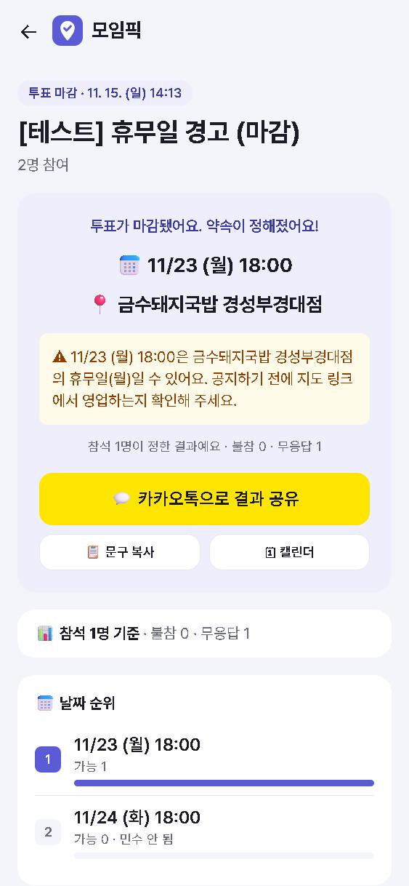

*휴무일 경고. 왼쪽부터 장소 카드, 순위, 확정 결과. (기능 확인을 위해 휴무일을 임의로 넣은 화면으로, 실제 가게 정보가 아니다)*

## AI와의 협업 과정

이번 주에는 직접 써 보다 걸린 걸 그대로 말하면 AI가 원인을 찾아 고치는 일이 많았다. 광안리를 후보로 넣었더니 해수욕장이 요약된다고 알려 주자 해변 이름 규칙이 생겼고, 송정처럼 여러 지역에 있는 이름은 규칙을 정해야 할 것 같다고 하자 규칙 후보가 나왔다. 그중 모르면 지역을 물어보는 방식은 사용자가 귀찮아할 것 같아서, 요약만 건너뛰고 링크로 직접 확인하게 해 달라고 했다. 빽다방 부경대처럼 가게 이름과 대략적인 위치를 함께 적으면 둘을 연결해 가장 가까운 지점을 찾게 해 달라고, 방법까지 정해서 시킨 것도 있다.

캡처로 명단 채우기는 Gemini로 이름을 뽑아내는데, 무료 API라서 보낸 내용이 구글 쪽에 로깅될 수 있는 것으로 알고 있었다. 그래서 캡처에 같이 찍히는 친구들의 프로필 사진이 개인정보 면에서 마음에 걸렸고, 이걸 어떻게 해결할지 AI에게 물었다. 프로필 사진 부분은 잘라 내고 이름 목록 부분만 보내면 된다는 답이 왔다. 처음에는 사용자가 캡처한 사진을 직접 잘라서 올리라는 말인 줄 알고, 그러면 귀찮아서 아무도 안 쓰겠다고 생각했다. 그런데 알고 보니 서버로 보내기 전에 브라우저 안에서 자동으로 잘라 내는 기능을 만든다는 뜻이었다. 사용자는 캡처만 고르면 되고 사진은 폰 안에서 처리된다는 게 신기했고, 그렇게 만들었다. 만든 뒤에는 실제 캡처로 써 보고, 성까지 잘려서 이름이 같아지면 한 명이 사라진다는 점과 사진이 한 장만 올라간다는 점을 짚어 고쳐 달라고 했다.

첫 화면을 바꿀 때는 AI와 의견을 주고받으며 정했다. 내가 만든 모임 상자는 진행 중 목록과 겹쳐서 필요 없을 것 같다고 하자, AI는 그 화면이 오래된 모임 보기와 카카오 연결을 맡고 있다는 점을 짚었다. 그래서 상자는 없애되, 오래된 모임은 "지난 모임 모두 보기"로, 카카오 연결은 첫 화면 맨 아래 한 줄로 옮겼다.

## 배운 것

이번 주에는 직접 써 보면서 예상하지 못한 문제를 많이 발견했다. 가짜 캡처로는 잘 되던 명단 채우기가 실제 캡처에서는 성을 잘랐고, 가게 이름만 생각하고 만든 장소 검색은 "서면"이나 "송정" 앞에서 엉뚱하게 동작했다. 처음부터 이런 입력까지 생각했어야 했는데, 실제로 넣어 보기 전까지는 놓치고 있었다.

개인정보도 생각보다 신경 쓸 게 많았다. 편하게 만드는 것만 생각하면 금방이었지만, 캡처에 다른 사람의 얼굴이 들어 있다는 걸 생각하니 무엇을 보내고 무엇을 남기지 않을지부터 정해야 했다. 그 과정에서 AI가 생각보다 많은 걸 할 수 있다는 것도 알게 됐다. 나는 캡처를 서버로 보내기 전에 폰 브라우저 안에서 잘라 낼 수 있다는 것조차 생각하지 못했는데, AI는 그 방법을 알고 있었고 실제로 만들어 냈다.

마지막으로, 자동 테스트는 생각보다 바로 쓸모가 있었다. 강의 조건이라 만들기 시작했는데, 만든 그날 바로 버그를 하나 잡았다.

다음 주에는 드디어 친구들에게 링크를 돌려 실제로 약속을 잡아 보게 하고, 1편에서 정한 대로 투표율과 정해지기까지 걸린 시간, 카톡 투표보다 편했는지를 확인할 예정이다.

## + 2편 "아직 못 한 것" 점검

| 2편의 아직 못 한 것 | 지금 |
|---|---|
| 휴무일 경고 | 완료. 장소 카드, 순위, 확정 결과에 표시 |
| 익명 모드 | 계속 보류 |
| 실제 사용 평가 | 다음 주로. 친구들에게 아직 돌리지 못함 |
| 모임장의 후보 삭제, 마감 연장 | 완료. 모임장 메뉴 |
| 인원이 많을 때 화면 | 일부. 명단 접기·총 인원 표시는 했고, 이름 검색은 써 보고 필요하면 |
| 단톡방 인원 스크린샷으로 명단 자동 추가 | 완료. 여러 장, 얼굴 줄 자르기 |

## + 그 밖에 바꾼 것들

| 무엇을 | 왜 | 어떻게 |
|---|---|---|
| PC 마우스 커서 | 버튼에 올려도 누를 수 있는지 안 보임 | 버튼·선택 칸에 손가락 커서 |
| 장소 카드의 지역 표시 | 다른 지역 가게가 잡혀도 눈치채기 어려움 | 요약이 끝난 장소는 이름 옆에 지역(예: 부산 수영구) |
| 캡처 읽기 횟수 | 무료 AI 한도 보호 | 10분에 5번까지 |
