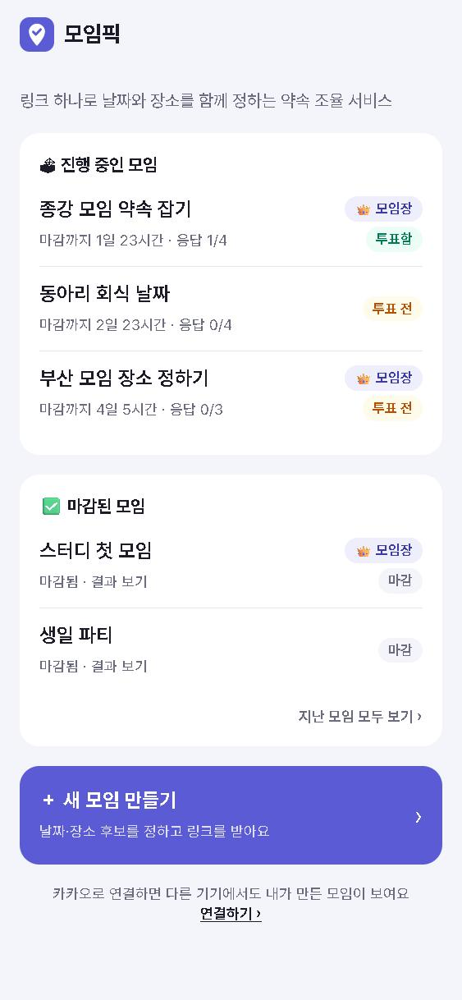
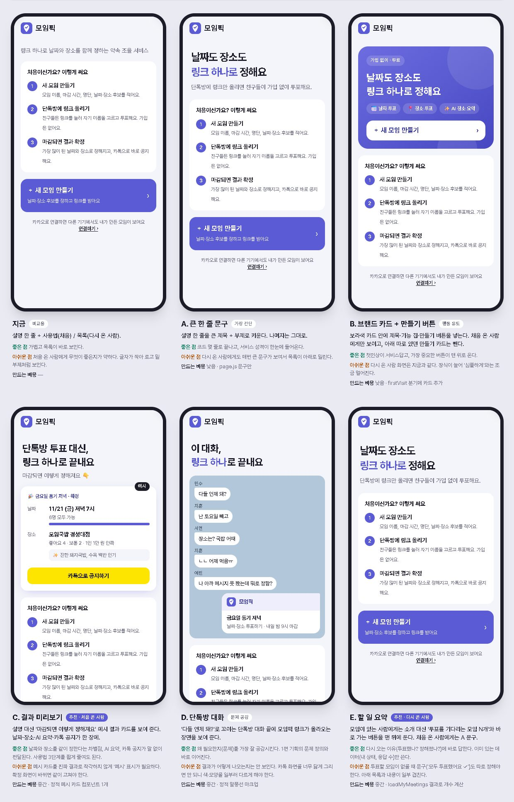
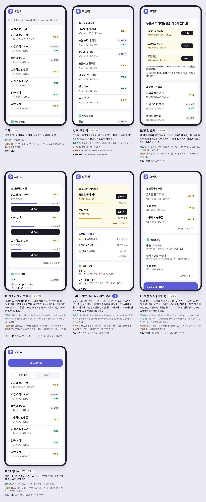
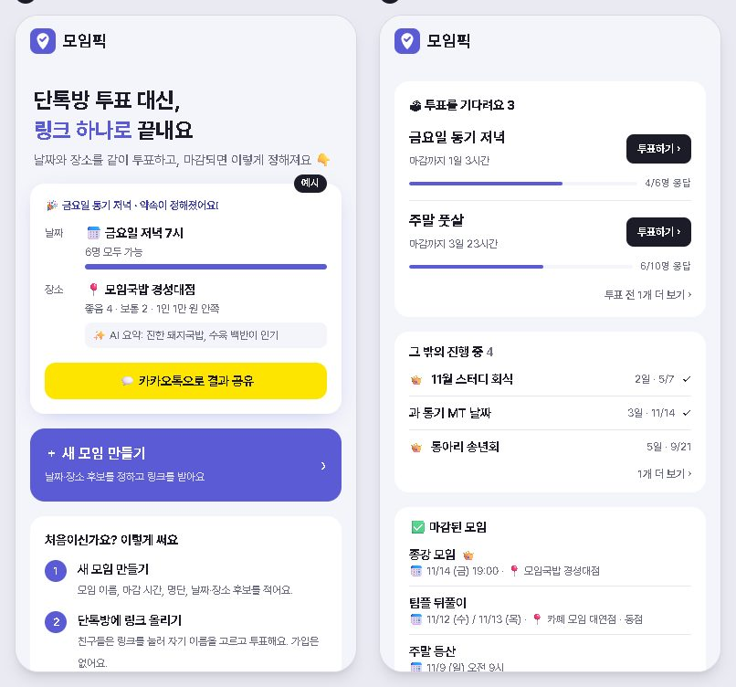
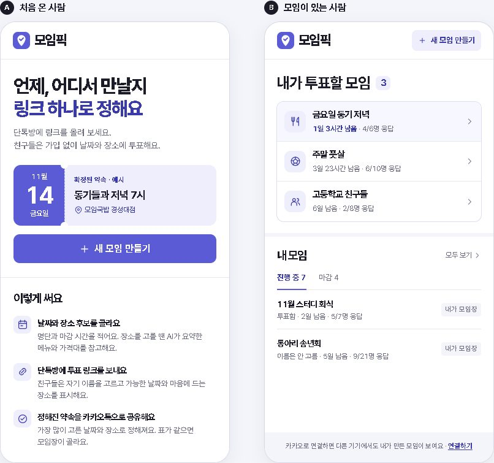
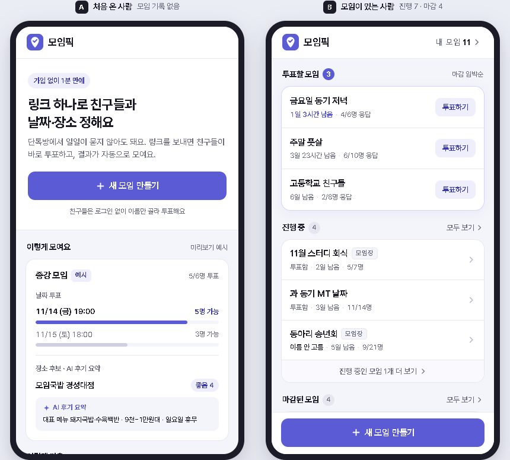
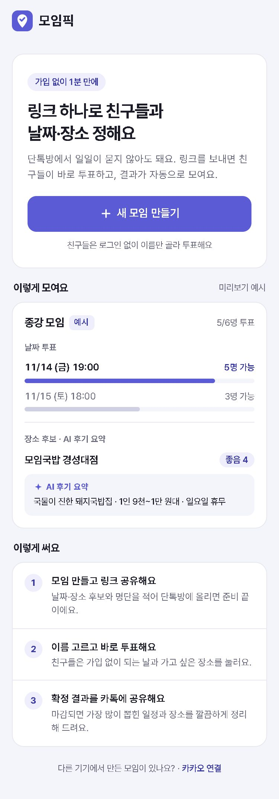
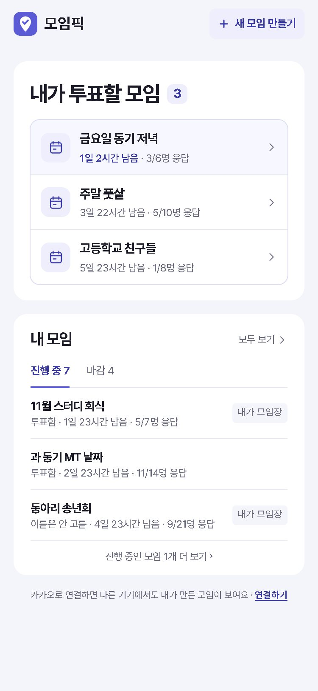
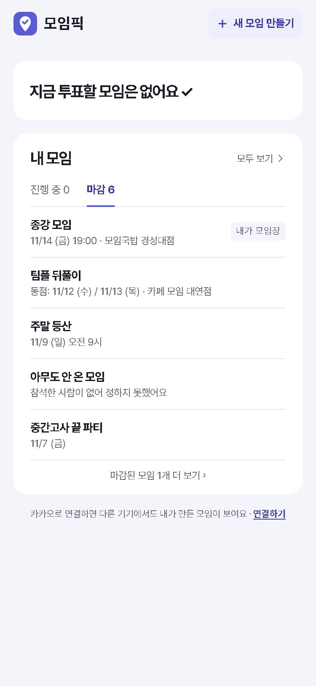

2편과 3편 끝에서 "친구들에게 링크를 돌려 실제로 약속을 잡아 보게 하겠다"고 두 번 예고했는데, 이번 주에도 시작하지 못했다. 첫 화면과 테스트·개발 환경을 먼저 정리하다 보니 순서가 밀렸다. 이번 주에 다시 그린 건 모임을 처음 만들거나 내 모임을 확인하러 들어왔을 때 보는 첫 화면이고, 실제로 쓰기 시작하기 전에 확인 수단과 개발 환경도 정비했다.

이번 글은 한 순서대로 정리했다. 처음에는 Claude가 만든 시안들 중에서 첫 화면을 골랐고, 이어서 기술 쪽을 다듬었고, 마지막에는 같은 조건을 주고 GPT와 Gemini에게도 시안을 받아 세 AI의 디자인을 비교한 뒤 골라서 앱에 넣었다.

## 첫 화면에 무엇을 보여 줄까

3편까지의 첫 화면은 맨 위에 "링크 하나로 날짜와 장소를 함께 정하는 약속 조율 서비스"라는 설명 한 줄만 있었다. 처음 온 사람에게는 이게 무슨 서비스인지 잘 와닿지 않고, 다시 온 사람에게는 목록만 길게 이어졌다.

  

*3편 시점의 첫 화면. 설명 한 줄 아래로 진행 중인 모임과 마감된 모임이 이어진다.*

그래서 맨 위 영역(히어로)을 어떻게 바꿀지 Claude에게 시안을 받아 보기로 했다. 지난 수업에서 교수님이 AI에게 디자인 시안을 HTML 파일로 받아 보는 명령문 팁을 알려 주셨는데, 그 방식을 참고해서 써 봤다.

전에는 "첫 화면을 어떻게 바꾸면 좋을까?"처럼 말로 물어보고 글로 된 답을 받았는데, 그러면 머릿속으로 화면을 그려 봐야 해서 비교가 잘 안 됐다. 시안을 HTML 파일로 만들어 달라고 하니 실제 폰 화면처럼 그려진 결과를 브라우저에서 바로 열어 볼 수 있었고, 어떤 안이 나은지 훨씬 빨리 판단할 수 있었다.

받은 시안은 폰 크기 화면 여러 개를 한 페이지에 모은 HTML 파일이었고, 시안마다 좋은 점, 아쉬운 점, 만드는 비용이 적혀 있어서 비교하기 쉬웠다.

*처음 온 사람 화면 시안. 지금 화면(비교용)과 A 큰 한 줄 문구, B 브랜드 카드, C 결과 미리보기, D 단톡방 대화, E 할 일 요약. E는 다시 온 사람용 안이라 처음 온 사람 화면에서는 A와 같다. (예시 가게는 지어낸 이름이다)*

시안을 보다가 한 가지를 놓치고 있었다는 걸 알았다. 단톡방에 올리는 링크는 모두 모임 화면 주소라서, 초대받은 친구는 첫 화면을 거치지 않고 투표 화면으로 바로 들어간다. 첫 화면을 보는 사람은 모임을 처음 만들어 보려는 사람과, 내 모임을 확인하러 다시 온 사람뿐이었다.

"처음 온 사람"을 무엇으로 구분하는지도 확인했다. 방문 횟수가 아니라, 이 기기에서 찾을 수 있는 내 모임(만든 모임, 이름을 고른 모임, 카카오로 연결한 모임)이 하나라도 있는지로 나뉜다.

처음 온 사람 화면은 C(결과 미리보기)로 정했다. "날짜와 장소를 같이 정한다"는 점을 설명 대신 결과 한 장으로 보여 줄 수 있어서다. B(브랜드 카드)는 만들기 버튼이 맨 위에 있어서 바로 만들려는 사람에게는 더 빠른데, C는 예시 카드 때문에 버튼이 화면 아래로 밀렸다. 그래서 C를 두고 만들기 버튼만 예시 카드 바로 아래로 올렸다.

C로 정한 뒤에도 B가 더 낫지 않을까 한 번 더 고민했다. 그런데 첫 화면을 보는 사람은 이미 만들 생각으로 온 사람보다 "이게 뭐 하는 서비스지?"부터 궁금한 사람이 더 많을 것 같았다. 설명은 C로 하고, 바로 만들려는 사람을 위한 B의 장점은 버튼 위치로 챙긴 셈이다.

## 모임이 있는 사람 화면

다시 온 사람의 화면도 문제가 있었다. 진행 중인 모임이 하나도 없으면 "진행 중인 모임이 없어요"라는 빈 칸이 맨 위를 차지했다. 투표 전인 모임에 표시는 있었지만, 어떤 모임이 내 투표를 기다리는지 보려면 목록을 훑어야 했다. 마감된 모임도 "결과 보기"를 눌러 들어가야 날짜와 장소를 알 수 있었다.

이번에도 시안을 받아 비교했다. 빈 칸만 정리하는 A, 할 일을 맨 위에 요약하는 B, 마감된 모임에 결과를 바로 보여 주는 C, 탭으로 나누는 D였다. 여기서부터는 내가 의견을 내면서 시안이 늘어났다.

먼저 진행 중인 모임이 많아지면 폰 화면이 길어지니, 투표 전인 모임을 1순위, 투표한 모임을 2순위로 두고 2~3개만 보여 준 뒤 나머지는 들어가서 보게 하자고 했다. 이건 C에 반영됐다.

이어서 마감된 약속은 24시간 동안만 보여 주자고 했는데, AI는 반대 의견을 냈다. 화면이 지저분해지는 원인은 개수보다 줄마다 붙은 버튼·막대·두 줄짜리 결과이고, 시간으로 숨기면 "어제 있던 모임이 어디 갔지?" 하는 혼란이 생긴다는 것이었다. 마감 시각으로 세면 다음 주 약속도 마감 다음 날 목록에서 사라진다. 개수 제한과 "모두 보기"가 더 예측하기 쉽다는 말에 동의했고, 줄 모양은 그대로 두는 절충안 E가 추가됐다.

마지막으로 B와 C가 마음에 드는데 너무 길어지지 않게, 투표 전인 모임만 크게 강조하고 나머지는 줄여 달라고 해서 F가 나왔다.

*모임이 있는 사람 화면 시안 (진행 중 7개, 마감 3개인 경우). 스크롤까지 포함한 전체 길이는 F가 922px로, B(1455px)와 C(1138px)보다 짧았다.*

F를 앱에 넣으면서 노란 배경은 빼고 흰색과 검정으로 바꿨고, 응답 막대만 기존 파란색으로 남겼다.

24시간만 보여 주자고 한 건 사실 마감된 모임이 쌓이면 화면이 지저분해질까 봐 낸 의견이었다. 숨기는 것보다 보여 주는 방식을 바꾸는 게 맞는 해결이었다. B와 C처럼 해야 할 일이 눈에 띄는 화면이 마음에 들었지만 폰에서 너무 길어지는 건 싫었고, 그 둘을 함께 만족시키는 쪽이 F였다. 노란 배경은 경고처럼 보여서 빼 달라고 했다.

## 기술 다듬기

첫 화면을 바꾼 뒤에는 화면 말고, 친구들이 쓰기 시작하기 전에 기술 쪽에서 다듬어 둘 것 세 가지를 먼저 했다.

**장소 판별 규칙 자동 테스트.** 3편에서 가장 많이 고친 곳이 장소 이름 판별(서면, 광안리, 송정, 빽다방 부경대)인데, 손으로만 확인하고 있었다. 이 규칙은 카카오 검색 결과를 받아 판단하기 때문에 테스트할 때마다 실제로 검색하면 키와 인터넷이 필요하다. 그래서 카카오가 돌려주는 모양대로 적은 가짜 검색 결과를 넣어 규칙만 확인하는 테스트 16개를 만들었다. 3편까지 쌓인 테스트 30개에, 앞에서 마감된 모임의 결과를 한 줄로 보여 주며 붙인 3개와 이번 16개가 더해져 자동 테스트는 모두 49개가 됐다. 테마거리 규칙을 일부러 끄자 테스트가 바로 실패로 잡아냈다.

**올릴 때마다 자동 검사(CI).** 내가 테스트 돌리는 걸 잊고 올려도, main에 코드를 올리면 GitHub가 코드 검사(lint)와 자동 테스트를 돌리고 실패하면 커밋 옆에 ✗를 띄운다. 배포 자체를 막지는 않지만, 깨진 채로 올라간 걸 바로 알 수 있다.

**연습용 로컬 DB.** 지금까지는 개발 서버가 실제 서비스와 같은 DB에 붙어 있어서, 화면을 확인하려고 시험 모임을 실제 DB에 넣었다 지웠다. 친구들이 실제로 쓰기 시작하면 위험한 방식이다. 3편에서 만든 Docker Compose의 DB를 개발 서버가 쓸 수 있게 해서, 이제 시험 데이터는 내 컴퓨터 안의 연습용 DB에만 넣는다. 이 글 뒤쪽의 지금 첫 화면 사진도 이 연습용 DB로 찍었다.

## 세 AI에게 같은 조건으로 시안 받기

앞에서 바꾼 첫 화면은 Claude가 만든 시안들 중에서 고른 것이다. 그러다 다른 AI에게 같은 일을 시키면 어떤 화면이 나올지 궁금해졌다. Claude가 "GPT라면 이렇게 했을 것"이라고 흉내 내는 건 의미가 없어서, 실제로 GPT와 Gemini에게 시안을 받기로 했다.

paseo(여러 AI 에이전트를 띄워 일을 맡기는 도구)로 GPT astra와 Gemini neon에게 각각 시안을 맡겼다. 두 AI에게 준 조건은 똑같이 맞췄다.

- 서비스 설명과 "초대받은 친구는 첫 화면을 보지 않는다"는 점
- 그릴 화면 두 개 (처음 온 사람 / 모임이 있는 사람)와 똑같은 예시 모임 11개 (진행 중 7, 마감 4)
- 지금까지 밝힌 내 취향: 투표 전은 눈에 띄게, 화면은 너무 길지 않게, 노란 배경은 싫음, 시간보다 개수 제한
- 브랜드 색, 글꼴, 로고
- 서로의 시안은 열어 보지 말 것, HTML 파일 하나만 만들고 앱 코드는 건드리지 말 것

다만 완전히 같은 출발선은 아니었다. Claude 버전은 앞에서 내 의견을 보태며 여러 번 다듬은 화면을 같은 예시 데이터로 다시 그린 것이고, GPT와 Gemini는 그 과정에서 정리된 내 취향을 조건으로 받아 서로의 시안을 보지 않고 한 번에 그린 것이다.

paseo는 Claude Code 안에서 실행했는데, Gemini neon은 권한 확인 없이 움직이는 모드로만 띄울 수 있어서 처음에는 Claude Code의 안전장치에 막혔다. 이 프로젝트에서만 paseo로 AI를 띄우는 것을 허용하도록 설정을 직접 바꾼 뒤에 실행했고, 끝난 뒤에는 각자 약속한 파일 하나만 만들었는지 확인했다.

  

*Claude 버전 (앞에서 앱에 넣었던 화면을 같은 예시 데이터로 다시 그린 것). 왼쪽 처음 온 사람은 결과 미리보기 카드, 오른쪽 모임이 있는 사람은 투표 전만 크게(F).*

  

*GPT 버전. 처음 온 사람에게는 날짜가 크게 찍힌 "약속표"(티켓 모양) 예시를, 모임이 있는 사람에게는 "내가 투표할 모임" 목록과 진행 중/마감 탭을 보여 준다. 모임이 있는 사람 화면에서는 새 모임 만들기를 맨 위 바의 작은 버튼으로 뒀다.*

  

*Gemini 버전. 처음 온 사람에게는 흰 머리 영역에 만들기 버튼을 먼저 두고 그 아래 예시 카드(날짜 투표 막대, 장소, AI 후기 요약)를 붙였다. 모임이 있는 사람에게는 투표할 모임, 진행 중 3개, 마감 2개(스크롤 아래)를 묶어 보여 주고 새 모임 만들기를 화면 아래에 고정했다.*

| | Claude (이전 앱) | GPT | Gemini |
|---|---|---|---|
| 처음 온 사람 | 확정 결과 예시 카드 → 만들기 버튼 → 사용법 | 날짜가 크게 찍힌 "약속표" 예시 → 만들기 버튼 → 사용법 | 만들기 버튼 → 투표 중인 예시 카드 → 사용법 |
| 투표 전 모임 | 2개만 크게 (응답 막대 + 투표하기) | 3개 모두, 아이콘 + 남은 시간·응답 수 | 3개 모두, 줄마다 투표하기 |
| 나머지 진행 중 | 한 줄씩 3개 | 진행 중/마감 탭에 2개 | 3개 + "1개 더 보기" |
| 마감된 모임 | 3개, 정해진 날짜·장소 | 마감 탭을 눌러야 보임 | 2개, 결과 + "2개 더 보기" |
| 새 모임 만들기 (모임이 있는 사람) | 목록 아래 큰 버튼 | 맨 위 바 작은 버튼 | 화면 아래 고정 |

같은 조건을 줬는데도 결과는 꽤 달랐다. 처음 온 사람에게 "무엇을 해 주는 서비스인지" 보여 주는 방법부터 셋이 갈렸다. Claude는 확정된 결과 카드를, GPT는 날짜가 크게 찍힌 약속표를, Gemini는 투표가 진행 중인 예시 카드를 꺼냈다. 만들기 버튼도 Claude와 GPT는 예시 아래에 뒀고, Gemini는 맨 위로 올렸다. 모임이 있는 사람 화면에서는 새 모임 만들기 버튼 자리가 목록 아래(Claude), 맨 위 바(GPT), 화면 아래 고정(Gemini)으로 나뉘었고, 마감된 모임도 Claude와 Gemini는 첫 화면에 바로 띄운 반면 GPT는 탭 뒤로 넣어 화면 길이를 줄였다.

비교 끝에 **처음 온 사람 화면은 Gemini 버전, 모임이 있는 사람 화면은 GPT 버전**으로 정했다.

처음 온 사람 화면은 Gemini 버전이 가장 깔끔했다. 만들기 버튼이 맨 위에 있어서 바로 만들려는 사람도 기다릴 필요가 없고, 예시 카드가 확정된 결과가 아니라 투표가 진행되는 모습을 보여 줘서 이 서비스를 어떻게 쓰는지가 더 잘 보였다. 앞에서 C를 고르며 고민했던 "설명"과 "바로 만들기"를 Gemini 버전은 처음부터 둘 다 챙기고 있었다.

모임이 있는 사람 화면은 GPT 버전이 가장 정돈돼 보였다. "내가 투표할 모임"이 제목부터 크게 보여서 다시 온 이유에 바로 답하고, 나머지 모임은 진행 중과 마감 탭으로 나눠서 모임이 많아도 화면이 길어지지 않았다. 이미 앱에 넣었던 Claude 버전(F)은 투표 전, 그 밖의 진행 중, 마감된 모임 세 칸이 모두 펼쳐져 있어서 모임이 많으면 결국 길어졌는데, GPT 버전은 그 문제를 탭 하나로 풀었다.

## 시안을 앱으로 옮기며 바꾼 것

시안을 그대로 옮길 수 없는 부분도 있었다.

- GPT 시안은 모임마다 포크·나이프, 축구공, 사람 아이콘을 붙였다. 알고 보니 GPT가 예시 모임 이름을 보고 직접 고르고, 아이콘 모양도 SVG 코드로 직접 그린 것이었다. 앱에는 모임 "종류"라는 정보가 없어서 모두 달력 아이콘 하나로 통일했다. 시안은 실제로 없는 데이터도 있는 것처럼 그릴 수 있다는 걸 이때 알았다.
- "모두 보기"는 그 자리에서 펼치는 대신, 지우기 같은 관리 기능이 있는 기존 "내 모임" 화면으로 보냈다.
- 투표할 모임은 3개까지만 보이고 더 있으면 "N개 더 보기"를 붙였다.
- Gemini 시안의 예시 카드에는 AI 요약에 "대표 메뉴"가 들어 있었다. 2편에서 대표 메뉴는 뒤죽박죽이라 카드에서 뺐는데, 시안 문구를 그대로 옮기다가 다시 들어갔다. 글을 검토하다 발견해서 실제 장소 카드처럼 한 줄 요약·가격·휴무만 남겼다.
- GPT 시안에 있던 작은 만들기 버튼은 모든 화면이 함께 쓰는 맨 위 바에 넣고, 모임이 있는 사람 화면에서만 보이게 했다. 처음 온 사람 화면에는 큰 버튼이 이미 있어서다.

배포한 뒤 PC에서 열어 보니 두 시안 모두 폰 화면 기준으로 흰 칸을 가장자리까지 꽉 채워 그려서, 가운데 좁은 칸만 보이는 PC에서는 각진 네모로 보였다. 다른 화면처럼 둥근 카드로 바꿨다. 또 진행 중인 모임이 없을 때 마감 탭에 2개만 보여서 아래가 텅 비었다. 위에 투표할 모임이 있으면 3개, 없으면 5개까지 보여 주고, 더 있으면 목록 아래에 "N개 더 보기"를 붙였다.

  
  
  

*지금 첫 화면. 왼쪽부터 처음 온 사람(Gemini), 모임이 있는 사람(GPT), 마감된 모임만 있는 사람. 가운데는 투표할 모임이 있어 내 모임 목록을 3개까지, 오른쪽은 마감된 모임만 6개라 5개까지 보여 주고 나머지 하나는 "1개 더 보기"로 남겼다. (내 컴퓨터의 연습용 DB에 예시 모임을 넣어 찍었다)*

## AI와의 협업 과정

이번 주에는 AI에게 디자인 시안을 여러 개 받아 비교하는 방식으로 화면을 정했다. 말로 "이런 화면"을 설명하는 것보다 폰 크기 시안을 한 화면에 모아 보니 차이가 훨씬 잘 보였고, Claude 시안에는 만드는 비용까지 적혀 있어 고르기도 쉬웠다.

다만 시안을 고르는 것과 방향을 정하는 건 내 몫이었다. 투표 전을 먼저 보여 주자, 개수를 줄이자, 노란 배경은 빼자, 모서리는 둥글게 하자는 건 시안과 화면을 직접 보며 낸 의견이다. 반대로 24시간만 보여 주자는 내 제안은 AI의 반대 의견을 듣고 바꿨다.

세 AI를 비교한 건 이번 주에서 가장 재미있었던 부분이다. 같은 조건을 줬는데도 셋이 서로 다른 답을 냈고, 어느 하나가 모든 면에서 낫지도 않았다. 그래서 한 AI의 시안을 통째로 고르기보다 화면별로 가장 나은 것을 골라 섞을 수 있었다. 한 AI에게만 물었다면 처음 받은 시안을 정답처럼 받아들였을 것 같다.

이번 검토도 같은 방식으로 했다. 이 글의 초안을 GPT와 Gemini에게 따로 검토받았더니, 둘 다 테스트 개수 계산이 틀린 것과 비교표의 순서 오류를 찾아냈고, Gemini는 첫 화면 예시 카드에 2편에서 뺀 대표 메뉴가 다시 들어간 것까지 짚었다. 다만 맞는 지적만 있었던 건 아니어서, 실제로 확인한 사실을 "확인 필요"라고 한 부분은 받아들이지 않았다.

## 배운 것

이번 주에 가장 크게 배운 건 화면을 바꾸기 전에 그 화면을 누가 보는지부터 따져야 한다는 점이다. 초대받은 친구가 첫 화면을 보지 않는다는 걸 몰랐다면, 정작 첫 화면을 보는 사람에게 필요 없는 설명을 늘어놓았을 것이다.

또 시안은 그럴듯해 보여도 실제 데이터와 맞는지 따로 확인해야 했다. GPT 시안의 모임별 아이콘은 앱에 없는 정보로 그린 것이었고, Gemini 시안의 대표 메뉴는 이미 뺐던 정보였다. 시안을 고르는 것과 앱에 옮기는 것은 다른 일이었다.

마지막으로, 시안을 여러 개 놓고 비교하니 고르기가 훨씬 쉬웠다. 하나만 보면 좋은지 나쁜지 판단하기 어려운데, 나란히 놓으면 무엇이 다른지가 먼저 보여서 내가 원하는 게 무엇인지도 분명해졌다.

이번 글을 쓰는 시점에는 아직 친구들과 실제 약속을 잡아 보지 못했다. 최종 제출 전에 결과를 받으려면 더는 미룰 수 없다. 링크를 돌리면 1편에서 정한 대로 초대받은 사람 중 몇 명이 투표했는지, 모임을 만든 뒤 약속이 정해지기까지 얼마나 걸렸는지 기록하고, 카톡 투표보다 편했는지도 물어볼 것이다. 이번 주 안에 실제로 약속을 잡아야 하는 친구 모임 1~2곳에 링크를 올리고, 마감되면 결과와 친구들의 반응을 다음 글에 정리하려고 한다.

## + 3편에서 예고한 일 점검

| 3편에서 예고한 것 | 지금 |
|---|---|
| 친구들에게 링크를 돌려 실제 사용 평가 (투표율·걸린 시간·카톡보다 편했는지) | 아직 시작하지 못함. 첫 화면과 기술 정비를 먼저 했다 |

## + 그 밖에 바꾼 것들

| 무엇을 | 왜 | 어떻게 |
|---|---|---|
| 블로그 첫 화면 | 쓰지 않는 "subscribe via RSS" 문구 | 숨김 |
